# High-Level Design (HLD)

## Distributed Event Log with Dynamic Consumer Rebalancing

| Field | Value |
|---|---|
| Project | #49 — Distributed Event Log with Dynamic Consumer Rebalancing |
| Document type | High-Level Design |
| Version | 1.2 |
| Status | Draft for review |
| Date | 2026-10-28 |
| Inputs | [requirements.md](requirements.md) (SRS v1.1), [writeup.pdf](writeup.pdf) |
| Next document | [low-level-design.md](low-level-design.md) (LLD v1.1) |

### Revision History

| Version | Date | Changes |
|---|---|---|
| 1.0 | 2026-10-27 | Initial draft |
| 1.1 | 2026-10-28 | Aligned with the LLD refinements ([LLD §17](low-level-design.md#17-refinements-to-the-hld)). R-1: binary frame header (§12.1). R-2: `CreateTopic` API (§6.3, §12.2). R-3: extended error codes (§12.3). R-4: credit-exact batch slicing (§6.2, §9.3). R-5: broker-wide `HwNotifier` (§6.2, §13). R-6: fencing only in the SQL CAS (§6.3, §8.2). R-7: HW over the union of current and pending ISR (§9.2, §9.9). Open issues OI-1 and OI-2 resolved (§20.2). |
| 1.2 | 2026-10-28 | Testing reduced to functional tests only (SRS v1.1): `Clock` abstraction replaced by plain time helpers (§6.1, §17); test hook points removed; ThreadSanitizer optional (§17); hand-off item 8 updated (§20.3). Read-only `DescribeGroup` request added for observability (§12.2, LLD R-8). |

---

## Table of Contents

1. [Introduction](#1-introduction)
2. [Architectural Drivers](#2-architectural-drivers)
3. [Architecture Overview](#3-architecture-overview)
4. [System Context](#4-system-context)
5. [Container View](#5-container-view)
6. [Component View](#6-component-view)
7. [Domain Model](#7-domain-model)
8. [Versioning, Epochs and Watermarks](#8-versioning-epochs-and-watermarks)
9. [Dynamic Behaviour (Sequence Diagrams)](#9-dynamic-behaviour-sequence-diagrams)
10. [State Machines](#10-state-machines)
11. [Data and Storage Architecture](#11-data-and-storage-architecture)
12. [Communication Architecture](#12-communication-architecture)
13. [Concurrency Model](#13-concurrency-model)
14. [Flow Control and Backpressure](#14-flow-control-and-backpressure)
15. [Failure Model and Recovery](#15-failure-model-and-recovery)
16. [Deployment View](#16-deployment-view)
17. [Cross-Cutting Concerns](#17-cross-cutting-concerns)
18. [Architecture Decision Records](#18-architecture-decision-records)
19. [Requirements Traceability](#19-requirements-traceability)
20. [Risks, Open Issues and LLD Hand-off](#20-risks-open-issues-and-lld-hand-off)

---

## 1. Introduction

### 1.1 Purpose

This document describes the high-level architecture of the distributed event log. It names the major runtime components, their responsibilities and interfaces, how they interact in normal and failure scenarios, and the key design decisions with their rationale. It is the bridge between the requirements ([requirements.md](requirements.md)) and the low-level design, which will specify class-level structure, algorithms, wire schemas and on-disk byte layouts.

### 1.2 Scope

The HLD covers every **Must** and **Should** requirement in the SRS. Details that do not affect component boundaries or cross-component contracts are deferred to the LLD and listed in [§20.3](#203-hand-off-to-low-level-design).

### 1.3 Notation

Diagrams use **UML 2.5** notation written in [Mermaid](https://mermaid.js.org/), so they render inline on GitHub, GitLab and VS Code (with a Mermaid extension).

| Diagram | UML / C4 type | Used for |
|---|---|---|
| `flowchart` | C4 Context / Container, UML Component, UML Deployment | Structure |
| `classDiagram` | UML Class | Domain model |
| `sequenceDiagram` | UML Sequence | Interactions |
| `stateDiagram-v2` | UML State Machine | Lifecycles |

### 1.4 Terminology

Terms follow the SRS glossary ([requirements.md §13](requirements.md#13-glossary)). Abbreviations used heavily here:

| Abbrev. | Meaning |
|---|---|
| LEO | Log End Offset — the next offset to be written on a replica |
| HW | High Watermark — the first offset that is *not yet* committed |
| ISR | In-Sync Replica set |
| CAS | Compare-and-set |
| GC | Group Coordinator (the process); never "garbage collection" in this document unless stated |

---

## 2. Architectural Drivers

### 2.1 Primary Functional Drivers

| Driver | Source |
|---|---|
| Per-partition ordered, durable, offset-addressable log | FR-PART, FR-LOG |
| Replication with committed-only reads, so no committed data is lost on single-broker failure | FR-REPL, FR-FETCH-01, INV-06 |
| Consumer groups with dynamic rebalance on join / leave / timeout | FR-GRP, FR-ASSIGN |
| **Fencing of stale offset commits (correctness centrepiece)** | FR-OFF-02…05, INV-03/04 |
| Bounded memory under overload via credit-based flow control | FR-BP, FR-FETCH-04/05 |
| At-least-once delivery with measurable duplication | FR-DEL |

### 2.2 Quality-Attribute Scenarios

| # | Attribute | Stimulus | Response | Measure |
|---|---|---|---|---|
| QA-1 | Correctness | A consumer is frozen past its session timeout, then wakes and commits | The commit is rejected with `STALE_EPOCH` | 0 offset regressions (E5) |
| QA-2 | Durability | The leader of a partition is `SIGKILL`ed | A new leader is elected from the ISR | 0 committed records lost (E6) |
| QA-3 | Availability | A consumer is `SIGKILL`ed | Its partitions are reassigned to survivors | Rebalance time ≈ session timeout + < 500 ms (E2) |
| QA-4 | Resource bound | Producer rate = 3× consumer capacity | Backlog grows on disk only | In-flight depth and RSS flat (E7) |
| QA-5 | Recoverability | Consumer crashes between process and commit | Resumes from the last committed offset | 0 skips, duplicates ≤ commit interval (E8) |
| QA-6 | Analysability | Any experiment run | Raw CSV plus config plus fault timeline are produced | All figures regenerate from data |

### 2.3 Constraints Shaping the Design

C++20; blocking sockets with thread-per-connection; single-threaded coordinator; `pwrite` segments; SQLite offset store; JSON control plane and MessagePack data plane; everything must run on one laptop (SRS §2.4, C-01…C-08).

---

## 3. Architecture Overview

### 3.1 Architectural Style

The system is a **leader-based replicated log** with a **centralised control plane**:

- **Data plane (brokers).** Stores and replicates partitions, and serves produce and fetch. It scales horizontally by adding brokers.
- **Control plane (group coordinator).** Is the single authority for *cluster metadata* (brokers, partition leaders, leader epochs, ISR) and *group state* (membership, assignment, generations, committed offsets). Every control decision is serialised on one thread.
- **Smart clients.** Run partitioning, batching, the group membership protocol, flow-control credit and commit policy in the client library. The client talks directly to partition leaders for data and to the coordinator for control.

### 3.2 Design Principles

| # | Principle | Consequence |
|---|---|---|
| P1 | **One writer per fact** | The leader alone appends to a partition. The coordinator alone mutates metadata, group state and offsets. |
| P2 | **Monotonic versions fence everything** | Leader epochs fence stale leaders. Ownership epochs fence stale consumers. Generations version assignments. |
| P3 | **Serialise instead of lock** | The coordinator processes one request at a time from a queue, so state transitions are atomic by construction. |
| P4 | **Persist before you acknowledge** | Offsets, generations, epochs and ISR changes are durable in SQLite before any reply that depends on them. |
| P5 | **Bound every queue** | Every buffer on the data path has a configured capacity. Overflow turns into blocking or a credit of 0, never growth. |
| P6 | **Disk is the buffer** | Backlog lives in the log, not in memory. |
| P7 | **Make failure observable** | Every fault, epoch change and rejection is logged and counted, so each experiment can be explained from its data. |

### 3.3 Architecture at a Glance

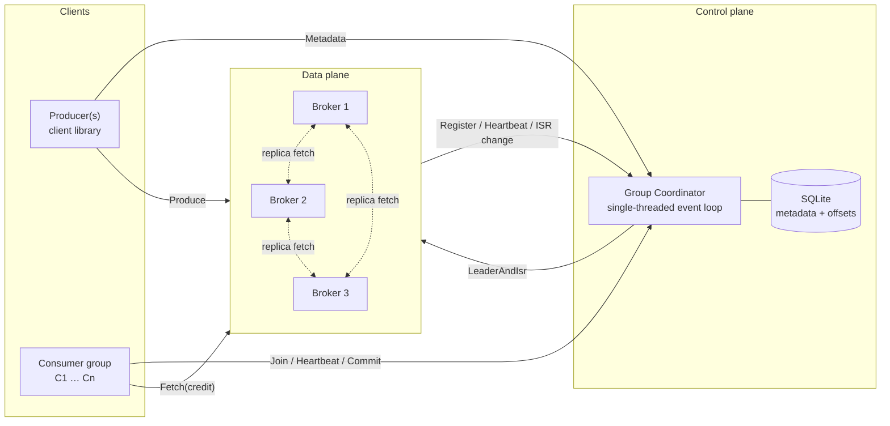

---

## 4. System Context

*C4 Level 1: the system as a black box and the actors around it.*

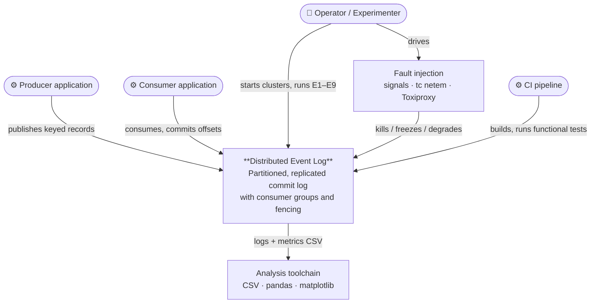

| External entity | Interaction | Interface |
|---|---|---|
| Producer application | Publishes records through the client library | C++ API (`Producer`) |
| Consumer application | Processes records, triggers commits | C++ API (`Consumer`) with a user callback |
| Operator | Configures, launches and observes | CLI, config files, Docker Compose, `make e<N>` scripts |
| Fault injection | Perturbs processes and network | POSIX signals, `tc netem`, Toxiproxy HTTP API |
| Analysis toolchain | Consumes metric output | CSV files plus run metadata JSON |
| CI | Builds and verifies | CMake, functional tests (pytest) |

---

## 5. Container View

*C4 Level 2: separately deployable or runnable units.*

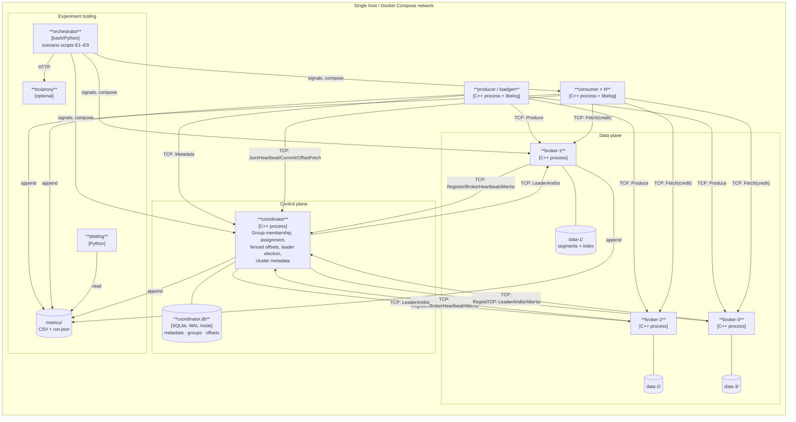

| Container | Technology | Responsibilities | Key SRS refs |
|---|---|---|---|
| `coordinator` | C++20 executable | Broker registry and liveness; leader election and epochs; ISR authority; group membership, rebalance and assignment; fenced offset commits | FR-GRP, FR-ASSIGN, FR-OFF, FR-REPL-02/06 |
| `coordinator.db` | SQLite (WAL, `synchronous=FULL`) | Durable metadata, group generations, partition ownership epochs, committed offsets | FR-OFF-04/06 |
| `broker` | C++20 executable | Partition replicas, segment storage, produce, replica fetch, consumer fetch, HW, retention | FR-LOG, FR-PROD, FR-REPL, FR-FETCH |
| `libelog` | C++20 static library | Producer and consumer client, partitioner, group protocol, credit, commit policy | FR-PROD, FR-FETCH, FR-BP, FR-DEL |
| `producer` / `consumer` | Executables over `libelog` | Synthetic workload, crash hooks (`--crash-after-process`), metric emission | FR-OPS-04, FR-DEL-04 |
| Orchestrator | Shell / Python | One-command scenarios, fault schedule, run metadata | FR-OPS-03, FR-FAULT |
| Plotting | Python (pandas, matplotlib) | Figures from raw CSV | FR-OBS-03 |

---

## 6. Component View

*UML Component level: internal building blocks of each container.*

### 6.1 Shared Libraries

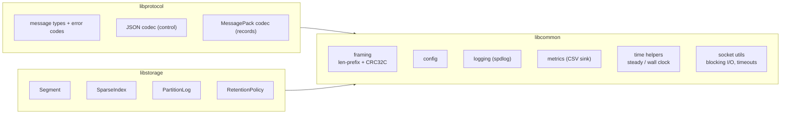

Module dependency rule: `broker → {storage, protocol, common}`, `coordinator → {protocol, common, sqlite}`, `libelog → {protocol, common}`. **No cycles. Only the broker links `storage`.**

### 6.2 Broker

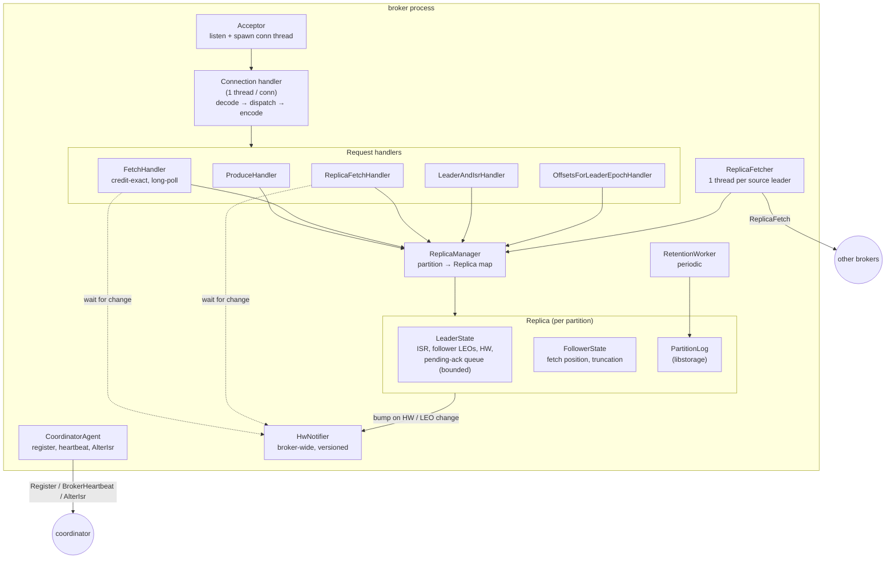

| Component | Responsibility |
|---|---|
| Acceptor / Connection handler | Accepts TCP connections. Each connection runs on its own thread: read frame, verify CRC, decode, dispatch, encode, write. Malformed frames close the connection (NFR-SEC-02). |
| ProduceHandler | Validates leadership and leader epoch, appends to the log, waits until HW ≥ the batch's last offset (committed-ack) or times out. |
| FetchHandler | Serves records in `[fetchOffset, HW)`, **exactly** at most `credit` records and `maxBytes`. Whole batches pass through unchanged. A batch that straddles `fetchOffset` or the credit boundary is **sliced** into a re-encoded sub-batch. When nothing is available it long-polls on the `HwNotifier`. |
| ReplicaFetchHandler | Serves followers from `[fetchOffset, LEO)`. Records the follower's LEO. Updates ISR membership and HW. |
| LeaderAndIsrHandler | Applies role changes and epochs pushed by the coordinator. Starts or stops the leader/follower state. |
| ReplicaManager | Owns every `Replica` on the broker and routes requests to it by `(topic, partition)`. |
| ReplicaFetcher | On followers, pulls from each leader and appends locally. Truncates divergent suffixes after an epoch change. |
| CoordinatorAgent | Registers the broker, heartbeats, proposes ISR changes (`AlterIsr`) and waits for them to be accepted. |
| RetentionWorker | Deletes closed segments that exceed the size or time retention. |
| HwNotifier | Broker-wide versioned condition. Bumped on every HW or leader-LEO change. One consumer or replica fetch can span many partitions, so it waits on this single notifier instead of one condition per partition. Produce waiters still use a per-replica condition (§13). |

### 6.3 Group Coordinator

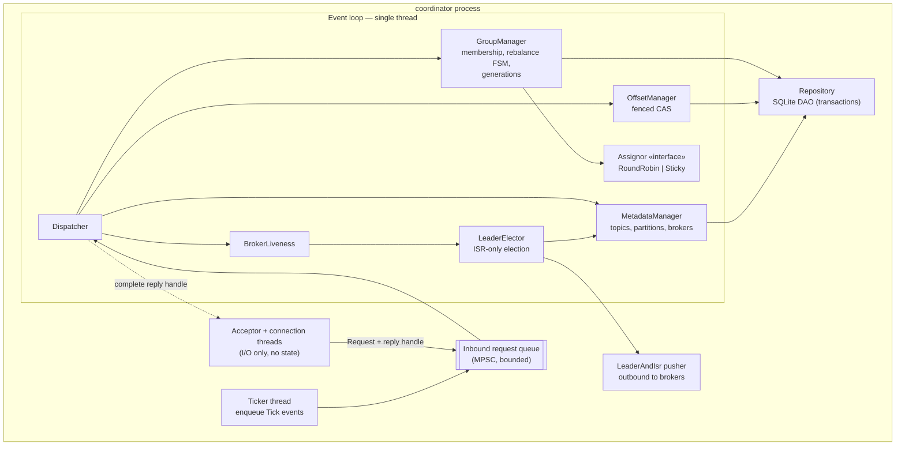

| Component | Responsibility |
|---|---|
| Inbound queue | Puts every client request, broker request and timer tick into one total order (constraint C-04, FR-GRP-09). |
| GroupManager | Runs the group state machine ([§10.1](#101-consumer-group-coordinator-side)), joins and leaves, the rebalance barrier, session-timeout eviction and generation bumps. |
| Assignor | Pure function `(members, partitions, previousAssignment) → assignment`. Deterministic and balanced (FR-ASSIGN-05/06). |
| OffsetManager | Fenced commit through one SQLite CAS statement, which is the **only** fencing check. There is no in-memory membership pre-check, so a commit from an evicted (zombie) member is rejected by the CAS with `STALE_EPOCH`. OffsetFetch. |
| MetadataManager | Topics, partitions, replica placement, leader, leader epoch, ISR. Answers `Metadata`, handles `CreateTopic` (initial replica placement) and `AlterIsr`. |
| BrokerLiveness / LeaderElector | Detects broker death by heartbeat timeout, elects a new leader from the ISR, bumps the leader epoch. |
| Repository | Every state mutation is persisted in a SQLite transaction **before** the reply is released (P4). |
| Deferred replies | `JoinGroup` replies are held until the rebalance barrier completes. The connection thread blocks on its reply handle. |

### 6.4 Client Library (`libelog`)

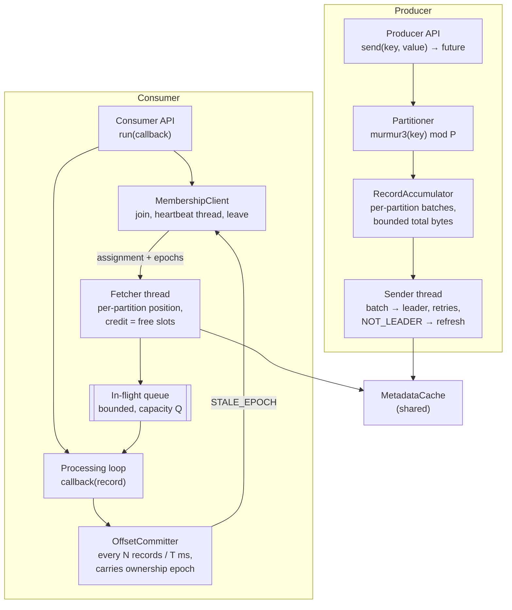

---

## 7. Domain Model

*UML Class diagram (conceptual). Attributes are illustrative. Exact types are in the LLD.*

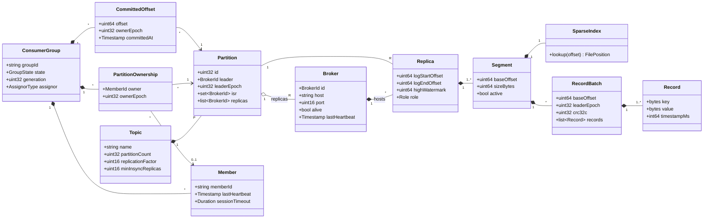

**Ownership.** The coordinator is authoritative for `Topic`, `Partition` metadata, `Broker`, `ConsumerGroup`, `Member`, `PartitionOwnership` and `CommittedOffset`. Brokers are authoritative for `Replica`, `Segment`, `SparseIndex` and record contents.

---

## 8. Versioning, Epochs and Watermarks

Correctness rests on four monotonic counters and two watermarks. Every component must agree on what they mean.

| Name | Scope | Owner (writer) | Incremented when | Fences | Persisted in |
|---|---|---|---|---|---|
| **Leader epoch** | Partition | Coordinator | A new leader is elected | Produce and replication from stale leaders; follower truncation point | SQLite + each batch header |
| **Group generation** | Group | Coordinator | Every completed rebalance | Heartbeats and joins from stale members; identifies the assignment version | SQLite |
| **Ownership epoch** | (Group, partition) | Coordinator | The partition's **owner changes** (set to the new generation) | **Offset commits from previous owners** | SQLite |
| **Broker incarnation** | Broker | Coordinator | A broker re-registers | Messages from a pre-restart incarnation | SQLite |
| **LEO** | Replica | Broker | Every append | — | Implicit in the log |
| **HW** | Partition | Leader | All ISR members have LEO > offset, and \|ISR\| ≥ minISR | Consumer visibility (committed-only reads) | Leader memory, checkpointed to disk |

### 8.1 Why a Separate Ownership Epoch?

With **sticky** assignment, a partition kept by the same member across a rebalance should go on committing without interruption (FR-ASSIGN-03). If commits were fenced on the *group generation*, every rebalance would invalidate every in-flight commit, which defeats stickiness. With a per-partition **ownership epoch**, only partitions that actually *moved* are fenced:

```
gen 4: P0→C1(e=4)  P1→C1(e=4)  P2→C2(e=2)  P3→C3(e=3)
       C3 dies → rebalance → gen 5 (sticky)
gen 5: P0→C1(e=4)  P1→C1(e=4)  P2→C2(e=2)  P3→C2(e=5)   ← only P3's epoch changes
       Zombie C3 later commits P3 with e=3 → 3 ≠ 5 → STALE_EPOCH
```

With **eager** assignment every partition is revoked, so every partition gets the new generation as its epoch.

### 8.2 Offset Commit Semantics

- A committed offset is the **next offset to consume** (Kafka convention). Committing `n` means records `< n` are processed.
- The fencing predicate, evaluated atomically in a single SQLite statement (ADR-05):

```
ACCEPT commit(g, p, offset, epoch, member)  ⇔
    ownership[g,p].owner = member  ∧  ownership[g,p].ownerEpoch = epoch
```

- This predicate, evaluated by the SQL statement, is the **single source of truth** for fencing. The coordinator does not check membership in memory first. A rejected commit always returns `STALE_EPOCH`, and that code is used for nothing else (leader-epoch fencing has its own `FENCED_LEADER_EPOCH`).
- Monotonicity (INV-03) follows from fencing plus process-then-commit. It is **asserted in tests, not clamped in the store**, so the E5 control run with fencing disabled can show regressions (ADR-06).

---

## 9. Dynamic Behaviour (Sequence Diagrams)

### 9.1 Cluster Bootstrap and Broker Registration

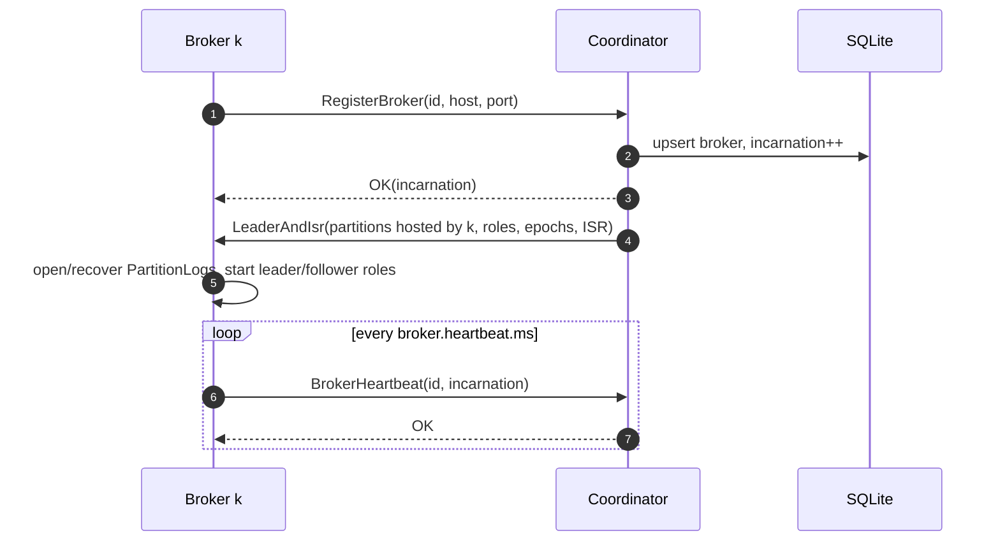

### 9.2 Produce with Replication and HW Advancement (committed-ack)

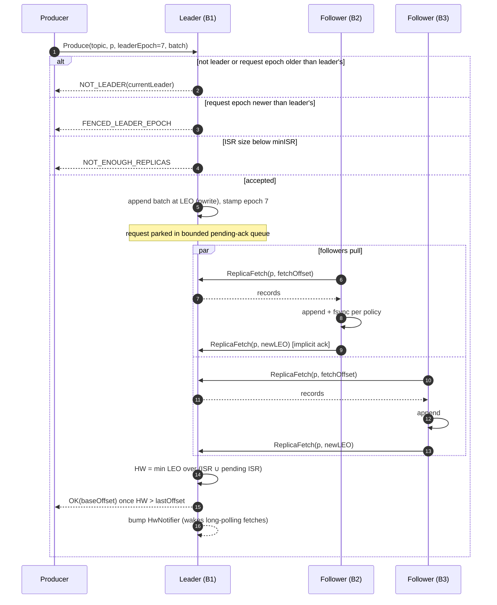

**Commit rule (ADR-03).** A record is committed when **every current ISR member** has persisted it **and** |ISR| ≥ `minISR` (default 2 for R = 3). Leaders are elected only from the ISR, so any new leader holds every committed record. This is the write-up's "quorum of the ISR" in a form that is lossless on failover.

While an `AlterIsr` is in flight, HW is computed over the **union** of the current and the proposed ISR (§9.9). Neither a shrink nor an expansion can then expose a record that the coordinator's view of the ISR does not hold.

### 9.3 Consumer Fetch with Credit

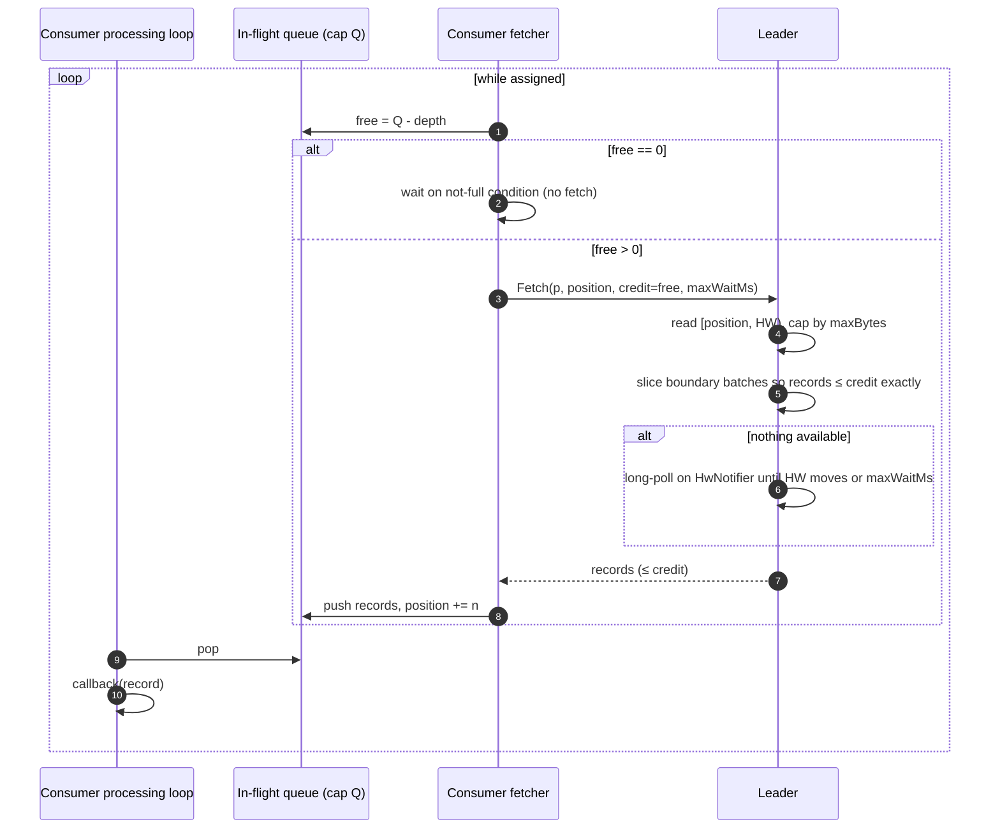

### 9.4 Join and Eager Rebalance

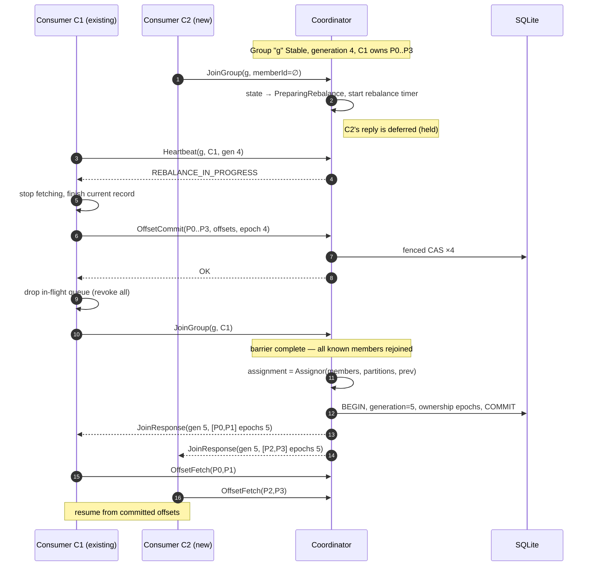

### 9.5 Sticky Rebalance (difference from eager)

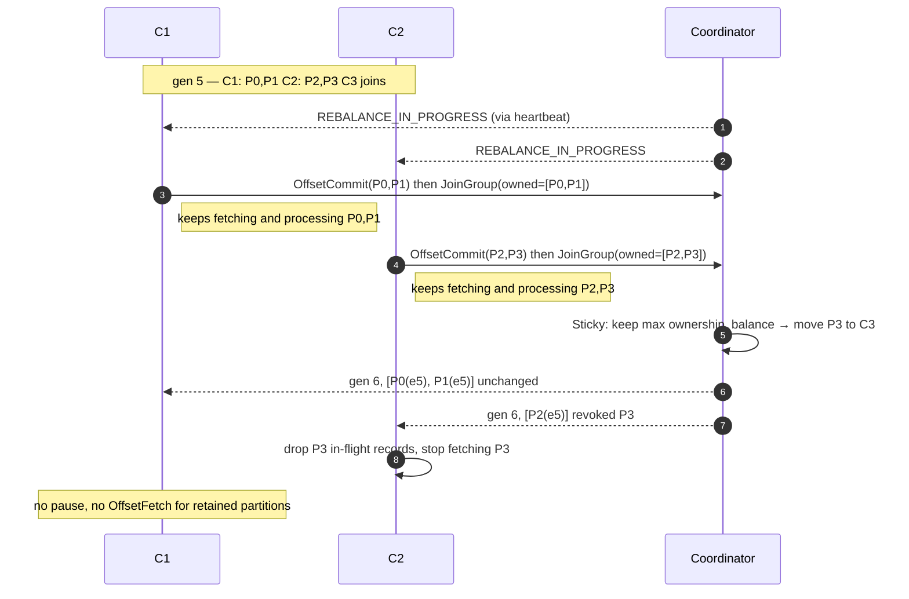

Only moved partitions stop. That is the effect E4 measures. Records C2 processed on P3 after its pre-join commit and before revocation are fenced (their epoch is now stale) and redelivered to the new owner, which is bounded at-least-once duplication. Two-phase cooperative revocation is out of scope.

### 9.6 Zombie Consumer Fenced (E5 — headline)

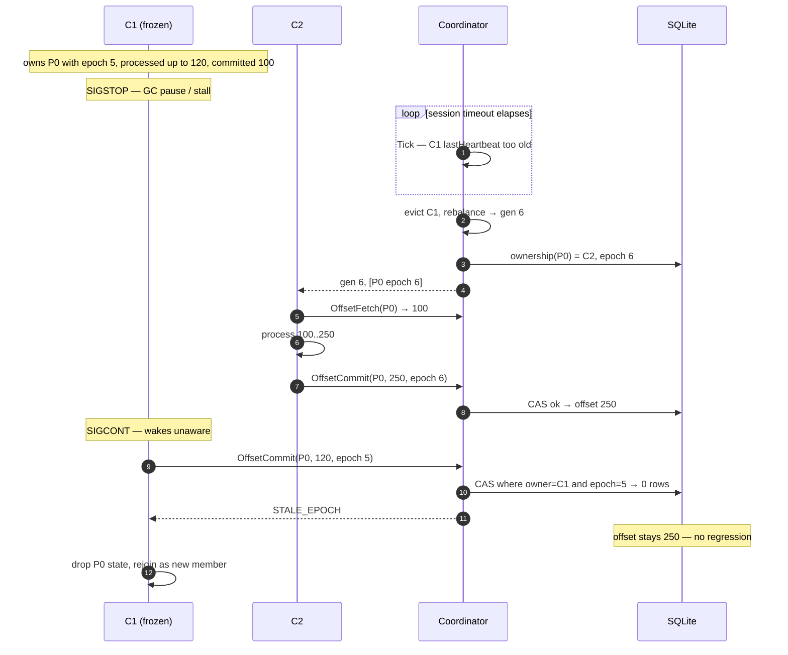

Without fencing (control run), step 13 would set the offset to 120, and C2's next restart would reprocess 120..250. That is the regression E5 counts.

### 9.7 Crash Between Process and Commit (E8)

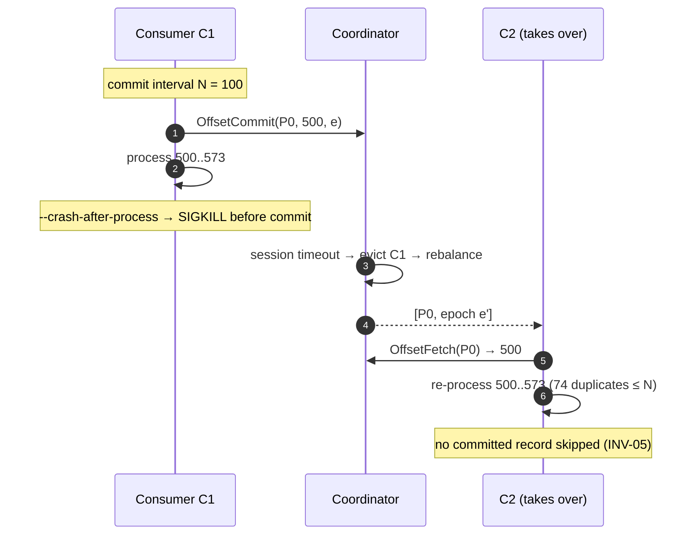

Expected duplicates per crash: uniform on `[0, N)`, mean ≈ N/2, linear in N (SRS E8).

### 9.8 Partition Leader Failover (E6)

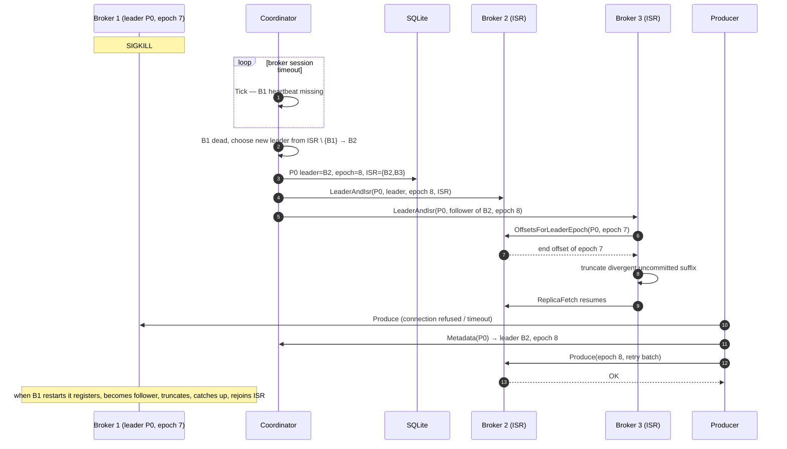

### 9.9 ISR Shrink (safety ordering)

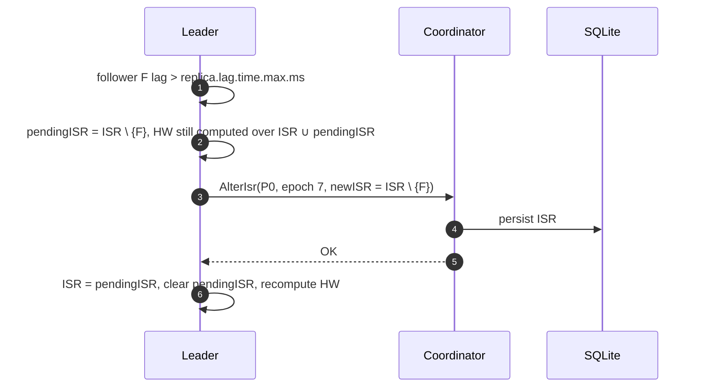

The leader advances HW under a smaller ISR **only after** the coordinator has persisted it. Until then, the "maximal ISR" (current ∪ pending) still includes `F`. Otherwise the coordinator could elect `F`, which lacks records already exposed as committed. ISR **expansion** is applied the same way, after the follower has caught up to HW.

---

## 10. State Machines

### 10.1 Consumer Group (coordinator side)

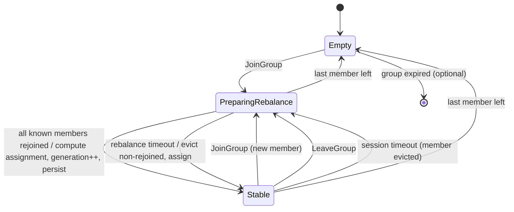

Commits are accepted in **both** `Stable` and `PreparingRebalance`, provided the ownership epoch matches. This lets members commit before rejoining.

### 10.2 Consumer Member (client side)

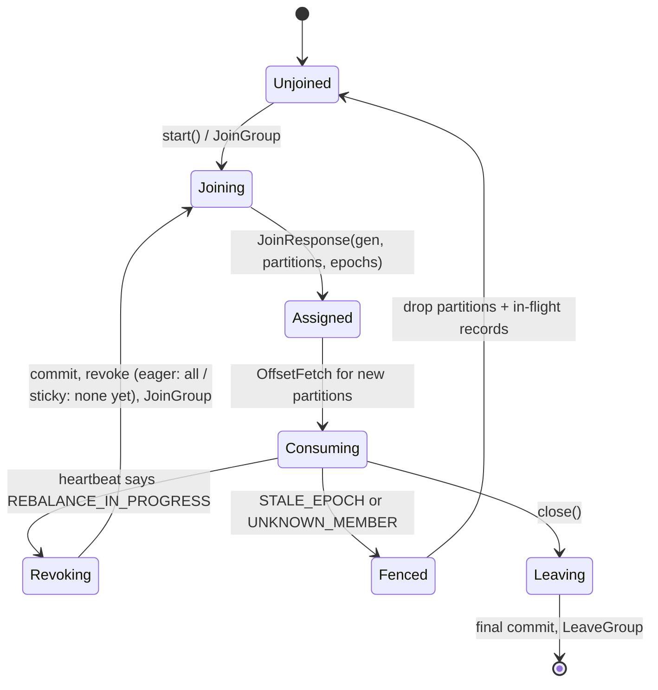

### 10.3 Partition Replica (broker side)

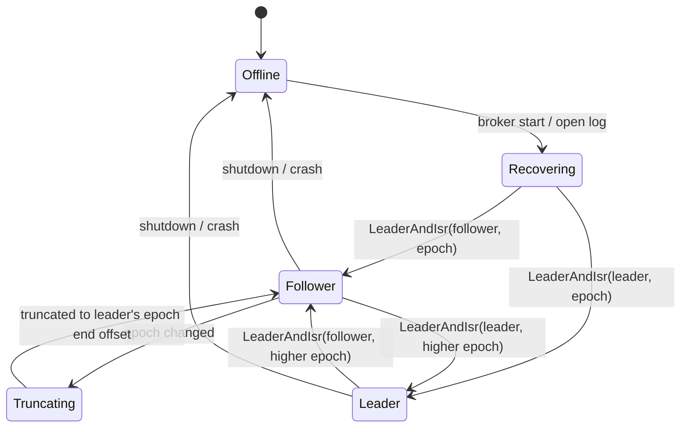

`Follower` has an orthogonal sub-status, **InSync** or **Lagging**, decided by the leader and made authoritative only by the coordinator (§9.9).

---

## 11. Data and Storage Architecture

### 11.1 Broker On-Disk Layout

```
data-<brokerId>/
├── meta.properties                 # broker id, format version
├── recovery-point.checkpoint       # last flushed offset per partition
├── high-watermark.checkpoint       # HW per partition (leader & followers)
└── <topic>-<partition>/
    ├── 00000000000000000000.log    # segment, named by base offset (20 digits)
    ├── 00000000000000000000.index  # sparse index: relOffset(u32) → filePos(u32)
    ├── 00000000000000052311.log
    ├── 00000000000000052311.index
    └── leader-epoch.checkpoint     # (epoch, startOffset) history for truncation
```

| Concern | Design |
|---|---|
| Write path | Single writer per partition; `pwrite` at the active segment tail; fsync per configured policy (`per-batch` / `interval` / `none`). |
| Record format | `RecordBatch { baseOffset, length, leaderEpoch, crc32c, count, records[] }`. The CRC covers everything after itself. |
| Read path | Floor-search segments by base offset → index floor lookup → forward scan. Reads are bounded by HW (consumers) or LEO (followers). |
| Rolling | When `segment.bytes` or `segment.ms` is exceeded. The closed segment becomes immutable. |
| Retention | Whole closed segments only, by `retention.bytes` / `retention.ms`. The log start offset advances. |
| Recovery | From the recovery point, rescan the active segment, verify CRCs, truncate the torn tail, rebuild missing or corrupt indexes (FR-LOG-08). |

### 11.2 Coordinator Store (SQLite) — Logical Schema

```mermaid
erDiagram
    BROKER ||--o{ PARTITION_REPLICA : hosts
    TOPIC ||--|{ PARTITION : has
    PARTITION ||--|{ PARTITION_REPLICA : "replicated as"
    CONSUMER_GROUP ||--o{ PARTITION_OWNERSHIP : assigns
    CONSUMER_GROUP ||--o{ COMMITTED_OFFSET : tracks
    PARTITION ||--o{ PARTITION_OWNERSHIP : "owned via"
    PARTITION ||--o{ COMMITTED_OFFSET : "position of"

    BROKER {
        int broker_id PK
        text host
        int port
        int incarnation
    }
    TOPIC {
        text name PK
        int partitions
        int replication_factor
        int min_isr
    }
    PARTITION {
        text topic PK
        int partition PK
        int leader
        int leader_epoch
        text isr
    }
    PARTITION_REPLICA {
        text topic PK
        int partition PK
        int broker_id PK
    }
    CONSUMER_GROUP {
        text group_id PK
        int generation
        text assignor
    }
    PARTITION_OWNERSHIP {
        text group_id PK
        text topic PK
        int partition PK
        text owner_member
        int owner_epoch
    }
    COMMITTED_OFFSET {
        text group_id PK
        text topic PK
        int partition PK
        int offset
        int owner_epoch
        int committed_at_ms
    }
```

- **Mode.** WAL journal, `synchronous=FULL`, one connection owned by the event-loop thread. There is no cross-thread access to SQLite.
- **Volatile vs. durable.** Member liveness (last heartbeat) is held **in memory only**. Generations, ownership epochs and offsets are **durable**, so fencing stays correct across a coordinator restart (§15).

---

## 12. Communication Architecture

### 12.1 Framing and Encoding

```
┌──────────────┬──────────────────────────────────────┬──────────────────────┬─────────────┐
│ length (u32) │ fixed binary header (12 bytes)       │ body                 │ crc32c (u32)│
│  big-endian  │ magic · version · apiKey ·           │ JSON (control) or    │ over header │
│              │ correlationId · encoding · flags     │ MessagePack (data)   │ + body      │
└──────────────┴──────────────────────────────────────┴──────────────────────┴─────────────┘
```

- The header is a **fixed 12-byte binary** structure, so a receiver can validate, route and match responses without parsing the body, and the CRC does not depend on the body encoding.
- Control-plane bodies are JSON, chosen for debuggability. Record payloads (Produce, Fetch, ReplicaFetch) are MessagePack, chosen for volume. The `encoding` header byte says which.
- `max.frame.bytes` is enforced before allocation. A bad magic byte or CRC mismatch returns `CORRUPT_MESSAGE` and the connection is closed.
- The byte-exact layout and every request/response schema are in [LLD §4](low-level-design.md#4-wire-protocol-protocol).

### 12.2 Request Routing

| Request | Client → Server | Handled by | Blocking semantics |
|---|---|---|---|
| `Metadata` | any → Coordinator | MetadataManager | Immediate |
| `CreateTopic` | `elogctl` → Coordinator | MetadataManager | Immediate, after persist. Idempotent for an identical spec. |
| `RegisterBroker`, `BrokerHeartbeat` | Broker → Coordinator | BrokerLiveness | Immediate |
| `AlterIsr` | Leader → Coordinator | MetadataManager | Immediate, after persist |
| `LeaderAndIsr` | Coordinator → Broker | LeaderAndIsrHandler | Immediate |
| `Produce` | Producer → Leader | ProduceHandler | Held until committed or `request.timeout.ms` |
| `ReplicaFetch` | Follower → Leader | ReplicaFetchHandler | Long-poll |
| `OffsetsForLeaderEpoch` | Follower → Leader | OffsetsForLeaderEpochHandler | Immediate |
| `Fetch` | Consumer → Leader | FetchHandler | Long-poll up to `fetch.max.wait.ms` |
| `JoinGroup` | Consumer → Coordinator | GroupManager | **Held until rebalance completes** |
| `Heartbeat`, `LeaveGroup` | Consumer → Coordinator | GroupManager | Immediate |
| `OffsetCommit`, `OffsetFetch` | Consumer → Coordinator | OffsetManager | Immediate, after persist |
| `DescribeGroup` | `elogctl` → Coordinator | GroupManager (read-only) | Immediate |

### 12.3 Error Handling Policy (client side)

| Error | Retriable | Client action |
|---|---|---|
| `NOT_LEADER` | Yes | Refresh metadata, retry against the new leader |
| `FENCED_LEADER_EPOCH` | Yes | Refresh metadata, retry (receiver has an older or newer leader epoch than the request) |
| `UNKNOWN_TOPIC_OR_PARTITION` | Yes | Refresh metadata, retry |
| `NOT_ENOUGH_REPLICAS` | Yes | Back off, retry |
| `THROTTLED` | Yes | Back off by the hinted duration |
| `REQUEST_TIMED_OUT` | Yes | Retry (may duplicate records in the log; accepted under at-least-once) |
| `REBALANCE_IN_PROGRESS` | Yes | Commit, revoke, rejoin |
| `STALE_EPOCH` | No (for this ownership) | **Offset commits only.** Drop affected partitions, rejoin. |
| `ILLEGAL_GENERATION` | No (for this generation) | Rejoin |
| `UNKNOWN_MEMBER` | No (for this membership) | Reset member id, rejoin |
| `OFFSET_OUT_OF_RANGE` | No | Apply `auto.offset.reset` |
| `INVALID_PARTITION_COUNT` | No | Surface to the operator (topic exists with a different partition count) |
| `STALE_BROKER_INCARNATION` | No | Broker re-registers |
| `UNSUPPORTED_VERSION`, `INVALID_REQUEST` | No | Bug or version mismatch. Fail fast with a logged error. |
| `CORRUPT_MESSAGE` | Yes (on a new connection) | Reconnect, retry |
| Socket error / timeout | Yes | Reconnect with backoff, refresh metadata |

The numeric codes are listed in [LLD §4.4](low-level-design.md#44-error-codes).

Retries are bounded (`retries`, `retry.backoff.ms` with jitter). Producer retries can duplicate records in the log; this is accepted under at-least-once (no idempotent producer).

---

## 13. Concurrency Model

| Process | Threads | Shared state and synchronisation |
|---|---|---|
| **Broker** | Acceptor ×1; connection ×N (one per socket); ReplicaFetcher ×(number of source leaders); CoordinatorAgent ×1; RetentionWorker ×1 | Per-`Replica` mutex guards appends and leader state. HW and LEO are published as `std::atomic<uint64_t>`. A per-replica `condition_variable` wakes produce waiters. The broker-wide `HwNotifier` wakes long-polling consumer and replica fetches, which may span many partitions. Closed segments are immutable, so reads need no lock. |
| **Coordinator** | Acceptor ×1; connection ×N (I/O only); **event loop ×1**; Ticker ×1; LeaderAndIsr pusher ×1 | **Only the event loop touches group, metadata and SQLite state.** Connection threads enqueue `(request, replyHandle)` and block on the handle. The ticker enqueues `Tick` events. No locks guard domain state. |
| **Consumer** | Main/processing ×1; Fetcher ×1; Heartbeat ×1 | The bounded in-flight queue (mutex + two condvars) connects fetcher and processor. Assignment changes cross threads via a versioned, mutex-guarded snapshot. |
| **Producer** | Caller threads; Sender ×1 | Bounded accumulator (mutex + condvar). Callers block when it is full. |

```mermaid
flowchart LR
    subgraph Coordinator
        T1["conn thread 1"] -- "enqueue(req, h)" --> Q[["MPSC queue"]]
        T2["conn thread 2"] -- "enqueue(req, h)" --> Q
        TK["ticker"] -- "Tick" --> Q
        Q --> EL["event loop<br/>(sole owner of state + SQLite)"]
        EL -. "h.complete(resp)" .-> T1
        EL -. "h.complete(resp)" .-> T2
    end
```

**Heartbeat isolation.** The consumer heartbeat thread is independent of processing, so slow processing does not cause false eviction. `SIGSTOP` freezes *all* threads, which is exactly the zombie case E5 needs.

---

## 14. Flow Control and Backpressure

```mermaid
flowchart LR
    P["Producer<br/>bounded accumulator<br/>(buffer.memory)"]
    subgraph Leader
        PQ[["pending-ack queue<br/>(bounded per partition)"]]
        LOG[("on-disk log<br/>= the backlog")]
    end
    C["Consumer<br/>in-flight queue (cap Q)"]
    APP["Processing callback"]

    P -- "Produce<br/>blocks when PQ full →<br/>TCP window fills" --> PQ
    PQ --> LOG
    LOG -- "Fetch(credit = Q − depth)<br/>returns ≤ credit" --> C
    C --> APP
    APP -. "slow → depth↑ → credit↓ → 0<br/>→ fetcher stops" .-> C
```

| Bound | Where | Effect when full |
|---|---|---|
| `buffer.memory` | Producer accumulator | `send()` blocks the caller |
| `max.pending.produce` | Leader, per partition | The connection thread stops reading the socket, so TCP backpressure reaches the producer |
| `consumer.inflight.max` (Q) | Consumer | Credit is 0, so no fetch is issued |
| `fetch.max.bytes` and credit | Broker FetchHandler | Response size is bounded, and record count is **exactly** ≤ credit (boundary batches are sliced), so broker memory per fetch is bounded |
| `max.frame.bytes` | All receivers | Oversized frames are rejected before allocation |
| `retention.bytes` | Broker disk | Oldest closed segments are deleted |

When producers outpace consumers (E7), unconsumed data stays **only on disk**: consumers take what their credit allows, broker fetch buffers are per-request and bounded, and lag (`LEO − committed`) grows in the log. Producers are throttled by replication and fsync capacity through the pending-ack bound, not by consumer speed. That is the decoupling a log provides.

---

## 15. Failure Model and Recovery

**Fault model:** crash-stop and crash-recover processes (`SIGKILL`); arbitrarily long pauses (`SIGSTOP`); network delay, loss and partition (`netem` / Toxiproxy). Out of scope: Byzantine faults, disk corruption beyond what CRC detects, and coordinator failover.

| Failure | Detection | Recovery | Guarantee | Exp. |
|---|---|---|---|---|
| Consumer crash | Session timeout | Rebalance. New owner resumes from the committed offset. | No skips; duplicates ≤ commit interval | E2, E8 |
| Consumer graceful leave | `LeaveGroup` | Immediate rebalance | No timeout wait | — |
| Consumer freeze (zombie) | Session timeout | Evict and reassign. The zombie's commits are fenced. | 0 offset regressions | E5 |
| Slow consumer | — (heartbeats continue) | Credit drops to 0. Backlog grows on disk. | Bounded memory | E7 |
| Follower crash or lag | Replica lag time | ISR shrink via the coordinator. Rejoins the ISR after catch-up. | HW keeps advancing while \|ISR\| ≥ minISR | E6 |
| Leader crash | Broker heartbeat timeout | ISR-only election, epoch++, follower truncation | 0 committed loss at R = 3 | E6 |
| Broker restart | Registration (new incarnation) | Log recovery, then follower role, truncate, catch up | Torn tail discarded | — |
| Network partition (broker ↔ coordinator) | Heartbeat timeout | The broker is treated as dead. Its stale-epoch requests are rejected after the partition heals. | No split-brain leader writes accepted | — |
| Coordinator crash | Clients see connection errors | Restart: reload SQLite. All groups become `Empty`. Members rejoin. Generations continue from the persisted value. | Fencing preserved across restart; availability lost until restart (documented SPOF, L-01) | — |
| Torn write or CRC failure | CRC on read and recovery | Truncate to the last valid batch | Only uncommitted data lost | — |

---

## 16. Deployment View

### 16.1 Single-Host Evaluation Topology (Docker Compose)

```mermaid
flowchart TB
    subgraph HOST["«device» Laptop — Linux x86-64, 4–8 cores, 8–16 GB, local SSD"]
        subgraph DOCKER["«execution environment» Docker Engine — bridge network elog-net"]
            direction TB
            CO["«container» coordinator<br/>:9000<br/>cpus 1, mem 512M"]
            B1["«container» broker-1<br/>:9101<br/>cpus 1, mem 1G"]
            B2["«container» broker-2<br/>:9102"]
            B3["«container» broker-3<br/>:9103"]
            CS["«container» consumer-1 … consumer-8<br/>cpus 0.5, mem 256M each"]
            PD["«container» producer / loadgen"]
            TX["«container» toxiproxy<br/>(when NET_ADMIN unavailable)"]
        end
        V1[("«volume» coord-db")]
        V2[("«volume» data-1..3")]
        V3[("«bind mount» ./runs/&lt;run-id&gt;/metrics")]
        ORC["«artifact» orchestrator scripts<br/>make e1 … make e9"]
    end

    CO --- V1
    B1 & B2 & B3 --- V2
    CO & B1 & CS & PD --- V3
    ORC -- "docker compose / kill -STOP / tc" --> DOCKER
```

| Aspect | Decision |
|---|---|
| Isolation | One container per process, with CPU and memory caps (NFR-REPRO-01) |
| Latency emulation | `tc netem` on container interfaces (needs `NET_ADMIN`), or Toxiproxy between clients and brokers |
| Storage | Docker volumes on local SSD. Never network mounts. |
| Images | One pinned build image (GCC 13 / Clang 17, CMake 3.25+) and a slim runtime image (NFR-REPRO-02) |
| Run artefacts | `runs/<timestamp>-<exp>/` holding CSVs, logs, `run.json` (config, seed, git SHA, fault timeline) |

### 16.2 Optional Multi-Node (RCE)

The binaries and configuration are the same; only the addresses differ. For example, node 1 runs the coordinator plus the load generator, nodes 2–4 run one broker each, and consumers are spread across nodes. No deliverable depends on this topology (SRS §8.3).

---

## 17. Cross-Cutting Concerns

| Concern | Approach |
|---|---|
| **Configuration** | Layered: built-in defaults < config file < CLI flags. Effective config logged at startup and written to `run.json` (IF-10/11). |
| **Logging** | spdlog, structured key=value. Mandatory fields: `ts`, `component`, `node`, plus `group`, `topic`, `partition`, `generation`, `epoch` where relevant. |
| **Metrics** | An in-process registry flushed periodically to per-process CSV (`ts, node, metric, labels, value`). Events such as rebalance start/end, fence rejection, leader change and fault injection go to a separate events CSV for timeline alignment. |
| **Time** | Timeouts and deadlines use the monotonic clock (`std::chrono::steady_clock`) through two small helpers. Wall time is used only for record and metric timestamps. |
| **Fault hooks** | `--crash-after-process` on the consumer. Fencing toggle (`coordinator.fencing.enabled`, default `true`); when off, a `FENCING_DISABLED` banner appears in logs and `run.json`. Everything else is injected from outside (signals, network). |
| **Testing** | Functional tests only (SRS §5.7): pytest scenarios start real processes, inject faults and check outcomes through `elogctl`, consumed records and the CSV outputs. |
| **Security** | Binds to the container network or loopback. Input is length- and CRC-validated. No authentication or TLS (out of scope, NFR-SEC-03). |
| **Build** | CMake targets `common`, `protocol`, `storage`, `broker`, `coordinator`, `elog` (client), `tools`. Presets `dev` (ASan+UBSan) and `release`, plus an optional `tsan` preset for a pre-submission race check. |

---

## 18. Architecture Decision Records

Summary form. Full ADRs, if needed, go in `docs/adr/`.

| ADR | Decision | Alternatives considered | Rationale | Consequence |
|---|---|---|---|---|
| **ADR-01** | One coordinator process owns **both** group coordination and cluster metadata / leader election | Raft-replicated controller; ZooKeeper / etcd | Scope fits a course project. A single serialisation point makes epochs trivially monotonic. | Documented SPOF (L-01); durable state survives restart |
| **ADR-02** | Coordinator is a **single-threaded event loop** behind an MPSC queue | Fine-grained locking | Atomic generation and epoch updates by construction; no deadlocks; easy to reason about | Throughput bounded by one core (ample for ~30 connections) |
| **ADR-03** | Commit = **all-ISR ack with minISR ≥ ⌈(R+1)/2⌉**; election **from the ISR only** | Majority quorum plus longest-log election | Every ISR member holds every committed record, so any ISR member is a safe leader. Election is simple. | A slow follower delays HW until it is dropped from the ISR (bounded by lag time) |
| **ADR-04** | **Per-partition ownership epoch** for fencing, distinct from group generation | Fence on group generation | Lets sticky assignment keep retained partitions committing across rebalances | One extra persisted integer per (group, partition) |
| **ADR-05** | Fencing via one **SQLite conditional UPDATE** (CAS) | Read-check-write in application code | Race-free in one statement and auditable; matches the write-up | Commit latency includes an fsync (WAL) |
| **ADR-06** | Offset **monotonicity is verified, not clamped** | Store-side `offset >= current` guard | A clamp would hide regressions and make the E5 control run meaningless | Monotonicity rests on fencing (checked by the E5 functional test and experiment) |
| **ADR-07** | **Server-side assignment** (coordinator runs the assignor) | Kafka-style leader-consumer assignment | Simpler protocol; deterministic; a single place to compare eager vs. sticky | Assignor changes need a coordinator restart (config only) |
| **ADR-08** | **Blocking I/O, thread-per-connection** | epoll / io_uring / coroutines | Adequate at about 30 connections; avoids coroutine lifetime bugs; natural TCP backpressure | Does not scale to thousands of connections (L-03) |
| **ADR-09** | **Credit-based fetch** with a bounded consumer in-flight queue | Unbounded prefetch; byte-based window only | Memory bounded by construction (E7); explicit and measurable | Credit is counted in records; bytes are capped separately by `fetch.max.bytes` |
| **ADR-10** | **Leader-epoch-based follower truncation** | Truncate to HW | Avoids the known HW-truncation data-loss and divergence anomalies | A leader-epoch checkpoint is kept per partition |
| **ADR-11** | **JSON control plane, MessagePack data plane**, behind a fixed binary frame header | Protobuf everywhere; JSON header | Readable control traffic for debugging; compact payloads; dispatch without parsing the body | Two codecs to maintain |
| **ADR-12** | **Credit-exact fetch by slicing boundary batches** | Whole batches only (may exceed credit) | FR-FETCH-04 requires "no more than credit". A batch larger than Q could otherwise never be delivered. | Re-encodes at most two batches per partition per fetch |
| **ADR-13** | **HW over the union of current and pending ISR** during `AlterIsr` | Apply the ISR change locally first | Keeps the leader's commit decisions consistent with the coordinator's persisted ISR, so an election can never pick a replica missing committed data | A shrink only speeds up HW after the coordinator round-trip |

---

## 19. Requirements Traceability

| SRS area | HLD sections | Key components |
|---|---|---|
| FR-PART | §6.4, §7 | Partitioner, MetadataManager |
| FR-LOG | §6.2, §11.1 | PartitionLog, Segment, SparseIndex, RetentionWorker |
| FR-PROD | §9.2, §12.3, §14 | Producer Sender, ProduceHandler |
| FR-REPL | §8, §9.2, §9.8, §9.9, §10.3 | LeaderState, ReplicaFetcher, LeaderElector |
| FR-FETCH | §9.3, §14 | FetchHandler, consumer Fetcher |
| FR-GRP | §9.4, §10.1, §10.2 | GroupManager, MembershipClient |
| FR-ASSIGN | §8.1, §9.4, §9.5 | Assignor (RoundRobin, Sticky) |
| FR-OFF | §8.2, §9.6, §11.2 | OffsetManager, Repository, OffsetCommitter |
| FR-BP | §14 | Accumulator, pending-ack queue, in-flight queue |
| FR-DEL | §9.7, §15 | OffsetCommitter, crash hook |
| FR-FAULT / FR-OBS / FR-OPS | §16, §17 | Orchestrator, metrics, logging |
| NFR-REL / NFR-AVL | §8, §9, §15 | — |
| NFR-PERF | §13, §14 | — |
| NFR-CONC | §13, ADR-02 | — |
| NFR-MAINT / TEST / REPRO / PORT | §6.1, §16, §17 | — |
| INV-01…10 | §8, §9.2–§9.9 | — |

---

## 20. Risks, Open Issues and LLD Hand-off

### 20.1 Design Risks

| Risk | Impact | Mitigation |
|---|---|---|
| Coordinator fsync per commit limits commit rate | Higher commit latency at small commit intervals | Fixed fsync policy per experiment; commit interval is the variable |
| Long-held `JoinGroup` occupies connection threads | Thread count = members (small) | Acceptable at target scale (ADR-08) |
| Sticky single-round revocation leaves a small duplicate window | Slightly more duplicates than cooperative two-phase | Reported in E4/E8 analysis |
| Clock skew between containers | Mis-ordered metric timelines | All containers share the host clock; single-host evaluation |

### 20.2 Open Issues

| # | Issue | Proposed resolution | Owner |
|---|---|---|---|
| OI-1 | Partition hash function | **Resolved:** MurmurHash3 x86_32, seed `0x9747b28c` ([LLD §10.2](low-level-design.md#102-partitioner)) | Decided |
| OI-2 | Default values: session timeout, heartbeat interval, lag time, broker timeout | **Resolved:** 6 s / 2 s / 10 s / 6 s, re-checked during E3 calibration ([LLD §12](low-level-design.md#12-configuration-catalogue)) | Decided |
| OI-3 | Should brokers verify consumer ownership on fetch? | No. Fencing protects offsets. Zombie reads only cause duplicate processing (allowed). | Decided |
| OI-4 | Group expiry for `Empty` groups | Retain offsets indefinitely within the project scope | Decided |

### 20.3 Hand-off to Low-Level Design

All items below are covered in [low-level-design.md](low-level-design.md). Refinements made there are reflected in this revision (v1.1). The LLD must specify:

1. **Class-level design** for each component in §6: interfaces, ownership and lifetimes (RAII, smart pointers), and the thread affinity of each method.
2. **Wire protocol:** byte-exact frame header, the JSON schema per control request and response, the MessagePack layout of record batches, and protocol versioning.
3. **On-disk formats:** byte layouts of segment, index and checkpoint files; recovery algorithm pseudocode.
4. **Algorithms:** HW computation, ISR shrink/expand, leader-epoch truncation, the rebalance barrier, the sticky assignor (with balance proof), and commit-interval policy.
5. **SQLite DDL** and the exact fenced CAS statement, plus transaction boundaries per request.
6. **Configuration catalogue:** every key, its default, valid range and owning component.
7. **Metric catalogue:** every metric, event, CSV column and plot it feeds.
8. **Test design:** functional scenarios per feature, mapped to the invariants and E1–E9.
9. **Source tree layout** and CMake target graph.
