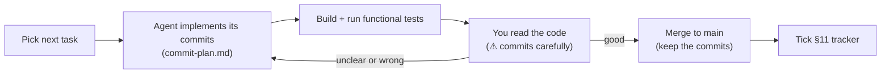
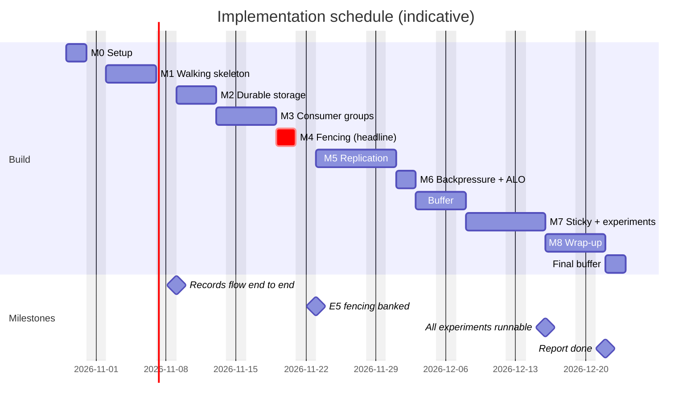

# Implementation Plan

## Distributed Event Log with Dynamic Consumer Rebalancing

| Field | Value |
|---|---|
| Project | #49 — Distributed Event Log with Dynamic Consumer Rebalancing |
| Document type | Implementation Plan |
| Version | 2.0 |
| Status | Active |
| Date | 2026-10-28 |
| Inputs | [requirements.md](requirements.md) (SRS v1.1), [high-level-design.md](high-level-design.md) (HLD v1.2), [low-level-design.md](low-level-design.md) (LLD v1.1) |
| Companion | [commit-plan.md](commit-plan.md): the commit-by-commit breakdown of every task below |

### Revision History

| Version | Date | Changes |
|---|---|---|
| 1.0 | 2026-10-28 | Initial plan |
| 2.0 | 2026-10-28 | Rewritten for a lighter course-project scope: **functional tests only**, walking skeleton first (durable storage moved after it), process reduced to what a solo developer needs, new §4 on code quality |

---

## Table of Contents

1. [Purpose and Assumptions](#1-purpose-and-assumptions)
2. [Strategy](#2-strategy)
3. [Way of Working](#3-way-of-working)
4. [Code Quality Guidelines](#4-code-quality-guidelines)
5. [Milestones](#5-milestones)
6. [Work Breakdown](#6-work-breakdown)
7. [Schedule](#7-schedule)
8. [Definition of Done](#8-definition-of-done)
9. [Risks and Scope Cut Lines](#9-risks-and-scope-cut-lines)
10. [Traceability](#10-traceability)
11. [Progress Tracker](#11-progress-tracker)

---

## 1. Purpose and Assumptions

This plan orders the work needed to build the system described in the LLD. It favours two things above all: **the system works**, and **the code is easy to read and maintain**.

| # | Assumption |
|---|---|
| A-1 | One developer (you) acts as architect, reviewer and experimenter. Coding agents write most of the code. |
| A-2 | This is a **course project, not a product**. No unit or property-based tests. Correctness is shown with **functional tests** (LLD §15) and the experiments. |
| A-3 | No fixed deadline. Durations are working days (d). The calendar in §7 is indicative, starting 2026-10-29. |
| A-4 | The LLD is the specification. If it turns out wrong, fix the LLD first (§3.3), then the code. |

---

## 2. Strategy

| # | Principle | What it means here |
|---|---|---|
| S1 | **Walking skeleton first** | By the end of M1, records flow producer → broker → consumer. Every later feature can then be seen working end to end the moment it lands. |
| S2 | **Prove features from the outside** | A feature is done when a functional test drives the real binaries and checks the result, not when the code compiles |
| S3 | **Centrepiece early** | Fencing (M4) comes before replication (M5), so the headline result (E5) is banked early |
| S4 | **Simple before clever** | Build the plainest version that meets the spec; optimise only if an experiment needs it |
| S5 | **Always runnable** | Every commit builds; every milestone ends with a demo you can run |

```
M0 Setup ─► M1 Skeleton ─► M2 Durable storage ─► M3 Groups ─► M4 FENCING ─► M5 Replication ─► M6 Backpressure/ALO ─► M7 Experiments ─► M8 Wrap-up
                ▲ first records flow                              ▲ headline E5     ▲ hardest part                            ▲ E1–E9
```

---

## 3. Way of Working

### 3.1 Per-Task Loop



- **Branches.** Work on `main`, or on one short-lived branch per task if you prefer. Merge with **rebase or fast-forward, never squash**, so the small commits survive.
- **Agent instructions.** Give the agent the task row from §6, the matching rows from the commit plan, and `CLAUDE.md`.
- **Parallel agents** are optional. Only run tasks in parallel when §6 shows no dependency between them.

### 3.2 What You Review

| Marker | Meaning | How to review |
|---|---|---|
| (none) | Plumbing: codecs, CLI, scripts | Skim. Check it reads clearly and matches the spec's names. |
| ⚠ | Correctness-critical: storage durability, HW/ISR, truncation, election, group state machine, fencing, assignors | Read every line next to the LLD pseudocode. Ask the agent to explain anything you can't follow. |

### 3.3 When the Spec Is Wrong

The agent stops and reports. You decide, and record the change in **LLD §17 (Refinements)**. The spec change goes in the same commit as, or before, the code that needs it.

---

## 4. Code Quality Guidelines

These go into `CLAUDE.md` (T0.2) so every agent session follows them.

| Area | Guideline |
|---|---|
| **Names** | Use the LLD's names for classes, methods and config keys. Names say what something *is*: `highWatermark`, not `hw2` or `tmp`. |
| **Size** | Functions fit on one screen (about 40 lines). Files under about 400 lines. One main class per header. |
| **Structure** | One responsibility per class. Handlers parse → validate → act → reply, in that order and visibly. |
| **Comments** | Explain *why*, not *what*. Every non-obvious rule cites its source, e.g. `// LLD §6.4: HW over ISR ∪ pending (ADR-13)`. |
| **Errors** | Return `Result<T>` / `Status` with an `ErrorCode`. No exceptions across module boundaries. Never swallow an error silently; log it or return it. |
| **Concurrency** | Each class states its thread rules in a header comment. Follow the lock order in LLD §11.2. Never do network I/O under a partition lock. |
| **Simplicity** | No speculative abstractions, template tricks or macros where a plain function works. Duplicate twice before abstracting. |
| **Logging** | One structured log line per significant event (key=value). No logging inside per-record hot loops. |
| **Formatting** | `clang-format` on every commit. |
| **Dependencies** | Only the libraries listed in LLD §2.3. |

---

## 5. Milestones

| ID | Milestone | Goal | Exit demo (functional tests) | Est. |
|---|---|---|---|---|
| **M0** | Setup | Repository, build, shared basics | `cmake --build` succeeds for `dev` and `release` | 2 d |
| **M1** | Walking skeleton | 1 broker + coordinator; produce and consume end to end | F-PF-1 … F-PF-4 | 5 d |
| **M2** | Durable storage | Rolling segments, index, recovery, retention | F-STO-1 … F-STO-6 | 4 d |
| **M3** | Consumer groups | Membership, rebalance, round-robin, offsets | F-GRP-1 … F-GRP-5 | 4 d |
| **M4** | **Fencing** ★ | Ownership epochs + fenced commit | F-FEN-1, F-FEN-2 | 2 d |
| **M5** | Replication | ISR, HW, truncation, leader election | F-REP-1 … F-REP-5 | 6 d |
| **M6** | Backpressure and at-least-once | Bounded memory, crash hook | F-BP-1, F-ALO-1 | 2 d |
| **M7** | Sticky + experiments | Sticky assignor, Docker, E1–E9 | F-ASG-1/2; `make e1` … `make e9` produce figures | 6 d |
| **M8** | Wrap-up | Race check, campaign, docs, report, demo | Final report; rehearsed live demo | 4 d |
| | | | **Subtotal** | **35 d** |

---

## 6. Work Breakdown

**Done when** is the observable check, usually functional tests from LLD §15.3. ⚠ marks tasks containing correctness-critical code.

### M0 — Setup (2 d)

| ID | Task | Spec | Deps | Done when |
|---|---|---|---|---|
| T0.1 | Project scaffold: CMake, presets (`dev`, `release`, optional `tsan`), pinned dependencies, `.clang-format` | LLD §2 | — | All presets configure and build |
| T0.2 | `CLAUDE.md`: build/run commands, §4 guidelines, lock order, "LLD is the spec", commit-plan rules | This doc §3–4 | T0.1 | You approve it |
| T0.3 | `common`: types, `Result`, time helpers, config loader, logging, sockets, `BoundedQueue`, metrics/events CSV writers | LLD §3, §12, §13.1 | T0.1 | Builds; exercised from M1 on |
| T0.4 | `protocol` basics: byte helpers, CRC32C, `ApiKey`/`ErrorCode`, frame codec | LLD §4.1–4.4 | T0.3 | Builds; exercised from M1 on |

### M1 — Walking Skeleton (5 d)

| ID | Task | Spec | Deps | Done when |
|---|---|---|---|---|
| T1.1 | Record batch format: builder, view with CRC check, stamp, slice ⚠ | LLD §4.5 | T0.4 | Exercised by F-PF-1 |
| T1.2 | Minimal `PartitionLog`: one segment, append and read (no index, rolling or recovery yet) | LLD §5.3–5.4 | T1.1 | Exercised by F-PF-1 |
| T1.3 | Message structs and codecs for metadata, topic, broker-control, produce and fetch messages | LLD §4.6–4.7 | T0.4 | Exercised by F-PF-1 |
| T1.4 | Broker: server, dispatcher, leader-only replica, produce with bounded admission, credit-exact fetch with long-poll ⚠ | LLD §6.1–6.2, §6.5–6.6 | T1.2, T1.3 | F-PF-1, F-PF-2, F-PF-4 |
| T1.5 | Coordinator: SQLite schema, single-threaded event loop, topics/metadata, broker registration, `LeaderAndIsr` push | LLD §7.1–7.2, §7.5, §8 | T1.3 | F-PF-3 |
| T1.6 | Client: RPC helper, metadata cache, partitioner, producer, manual-assignment consumer | LLD §10.1–10.3, §10.5 | T1.3 | Exercised by F-PF-1 |
| T1.7 | Tools: `elog-producer`, `elog-consumer` (writes processed/produced range CSVs), `elogctl` (`create-topic`, `describe-topic`, `dump`, `health`) | LLD §13.1, §15.2 | T1.6 | Manual run works |
| T1.8 | Functional test infrastructure, shared checks (order, loss), F-PF-1…4, CI workflow | LLD §15 | T1.4–T1.7 | 🎯 **M1 demo:** F-PF-1…4 green |

### M2 — Durable Storage (4 d)

| ID | Task | Spec | Deps | Done when |
|---|---|---|---|---|
| T2.1 | Sparse index and segment rolling; reads across segments ⚠ | LLD §5.2.2, §5.3–5.4 | T1.8 | F-STO-1, F-STO-2 |
| T2.2 | Checkpoint files, `meta.properties`, flush policies, broker scheduler | LLD §5.2.3–5.2.4, §5.8, §6.10 | T2.1 | Exercised by F-STO-3 |
| T2.3 | Startup recovery (torn tail, index rebuild) and `elogctl log-verify` ⚠ | LLD §5.6 | T2.2 | F-STO-3, F-STO-4, F-STO-5 |
| T2.4 | Retention by size and time | LLD §5.7 | T2.2 | F-STO-6 |

### M3 — Consumer Groups (4 d)

| ID | Task | Spec | Deps | Done when |
|---|---|---|---|---|
| T3.1 | Group messages, read-only `DescribeGroup`, `elogctl describe-group` | LLD §4.6 | T1.8 | Exercised by F-GRP-1 |
| T3.2 | `GroupManager`: state machine, rebalance barrier, ownership epochs, timeouts; round-robin assignor ⚠ | LLD §7.3, §9.1–9.2 | T3.1 | F-GRP-1, F-GRP-2, F-GRP-3 |
| T3.3 | Offset commit (unfenced for now) and offset fetch | LLD §7.4, §8.3 | T3.2 | F-GRP-4 |
| T3.4 | Client group consumer: membership, heartbeat thread, committer, eager rebalance ⚠ | LLD §10.4–10.7 | T3.1 | F-GRP-1…4 |
| T3.5 | Coordinator restart restores groups and generations | LLD §7.6 | T3.3 | F-GRP-5 |
| T3.6 | Shared checks (skips, duplicates) and group tests | LLD §13.4, §15.3 | T3.4 | 🎯 **M3 demo:** F-GRP-1…5 green |

### M4 — Fencing ★ (2 d)

| ID | Task | Spec | Deps | Done when |
|---|---|---|---|---|
| T4.1 | Fenced commit (single SQL CAS), fencing toggle, fencing events ⚠ | LLD §7.4, §8.3 | T3.6 | Exercised by F-FEN-1/2 |
| T4.2 | Client: `STALE_EPOCH` → revoke all, rejoin ⚠ | LLD §10.6 | T4.1 | Exercised by F-FEN-1 |
| T4.3 | Regression check, F-FEN-1/2, and your written walkthrough of the fencing path | LLD §15.3 | T4.2 | 🎯 **M4 demo:** F-FEN-1 (0 regressions) and F-FEN-2 (> 0) green |

### M5 — Replication (6 d)

| ID | Task | Spec | Deps | Done when |
|---|---|---|---|---|
| T5.1 | Replication message codecs | LLD §4.6 | T1.3 | Exercised by F-REP-1 |
| T5.2 | Leader/follower roles; HW over the maximal ISR with minISR ⚠ | LLD §6.3–6.5 | T5.1, T4.3 | Exercised by F-REP-1 |
| T5.3 | Replica fetching on both sides (handler and fetcher threads) ⚠ | LLD §6.7–6.8 | T5.2 | F-REP-1 |
| T5.4 | Leader-epoch cache, log truncation, `OffsetsForLeaderEpoch` ⚠ | LLD §5.5, §6.8 | T5.3 | F-REP-5 |
| T5.5 | ISR shrink/expand through `AlterIsr` ⚠ | LLD §6.7, §6.9, §7.5 | T5.3 | F-REP-3, F-REP-4 |
| T5.6 | Broker failure detection, ISR-only leader election, client recovery ⚠ | LLD §7.5, §10.3 | T5.4, T5.5 | 🎯 **M5 demo:** F-REP-2 (0 acked loss) and F-REP-5 green |

### M6 — Backpressure and At-Least-Once (2 d)

| ID | Task | Spec | Deps | Done when |
|---|---|---|---|---|
| T6.1 | Flow-control metrics (in-flight depth, credit, RSS, lag, pending produce) | LLD §13.2 | T3.6 | Exercised by F-BP-1 |
| T6.2 | `--crash-after-process` hook | LLD §14 | T3.6 | Exercised by F-ALO-1 |
| T6.3 | Backpressure and at-least-once tests | LLD §15.3 | T6.1, T6.2 | 🎯 **M6 demo:** F-BP-1 and F-ALO-1 green |

### M7 — Sticky Assignment and Experiments (6 d)

| ID | Task | Spec | Deps | Done when |
|---|---|---|---|---|
| T7.1 | Sticky assignor and client sticky path ⚠ | LLD §9.3–9.4, §10.6 | T4.3 | F-ASG-1, F-ASG-2 |
| T7.2 | Docker build and runtime images, `compose.yaml` | HLD §16 | T1.8 | `docker compose up` → `elogctl health` OK |
| T7.3 | Experiment helpers: run directory, `run.json`, fault injection | LLD §14, §16.1 | T7.2 | Dry run of each fault logs to `faults.csv` |
| T7.4 | Timing measurements (rebalance time, time to throughput, drain rate) | LLD §13.4 | T3.6 | Used by E2–E4, E9 |
| T7.5 | E1–E9 scripts and plots | LLD §16.2 | T7.3, T7.4, M5, M6 | `make e1` … `make e9` each produce figures and a `summary.json` |
| T7.6 | Calibration of workload rates and timeouts | LLD §12 | T7.5 | `experiments/CALIBRATION.md` committed |

### M8 — Wrap-Up (4 d)

| ID | Task | Spec | Deps | Done when |
|---|---|---|---|---|
| T8.1 | One functional-suite run under the `tsan` build; fix any races found ⚠ | NFR-CONC-01 | M7 | Suite passes under `tsan` |
| T8.2 | Experiment campaign (E1–E9, repeated); results summary | NFR-REPRO-04/05 | T8.1 | Aggregated figures with variance committed |
| T8.3 | README and reference docs (protocol, on-disk format) | NFR-MAINT-04 | M7 | A fresh clone builds and runs E1 from the README |
| T8.4 | Final report | SRS §9.2 | T8.2 | Every SRS §9.1 prediction addressed |
| T8.5 | Live demo script (E5 + E8) | SRS D6 | T8.2 | Two clean rehearsals |

**Totals:** 9 milestones, 45 tasks.

---

## 7. Schedule



About **40 working days** in total: 35 d of work plus 5 d of buffer. Most of the buffer sits after replication, the riskiest milestone.

---

## 8. Definition of Done

**A task is done when:**

- [ ] Its "Done when" check passes (usually named functional tests).
- [ ] All earlier functional tests still pass.
- [ ] Every commit builds; the history matches the commit plan, or deviations are noted there.
- [ ] Code follows §4. You have read it, and read every line of ⚠ code.
- [ ] Any spec change is recorded in LLD §17.

**A milestone is done when** its demo runs green from a clean build. Tag it `m0` … `m8`.

---

## 9. Risks and Scope Cut Lines

### 9.1 Risks

| Risk | Likelihood | Impact | Mitigation |
|---|---|---|---|
| Replication (HW, ISR, truncation) takes longer | High | High | Own milestone; buffer placed right after it; ⚠ reviews |
| Agent code passes the tests but is subtly wrong | Medium | High | Read ⚠ code line by line; the fencing walkthrough; tests that must fail (F-FEN-2) |
| Flaky timing-based functional tests | Medium | Medium | `wait_until` with deadlines, never fixed sleeps; generous margins |
| Code grows hard to follow | Medium | Medium | §4 guidelines in `CLAUDE.md`; small commits; ask the agent to simplify before merging |
| Docker or `NET_ADMIN` problems | Medium | Low | Toxiproxy fallback, or run experiments as plain processes |
| Results contradict predictions | Medium | Low | Allowed (SRS §9.2); report with analysis |

### 9.2 Cut Lines (apply in order if behind)

| Order | Cut | Priority in SRS |
|---|---|---|
| 1 | RCE multi-node runs | Could |
| 2 | Unkeyed partitioning; leader-only and fire-and-forget acks | Could |
| 3 | Fewer repeats (5 → 3) and fewer E3 sweep points | Should |
| 4 | CI workflow (run tests locally instead) | Should |
| 5 | Producer linger batching | Should |
| 6 | Long-poll (replace with a short poll interval) | Should |
| 7 | ThreadSanitizer pass | Should |

**Never cut:** fencing (E5), at-least-once with the crash hook (E8), replication with ISR election (E6), credit backpressure (E7).

---

## 10. Traceability

| Milestone | SRS requirements | Invariants shown | Experiments enabled |
|---|---|---|---|
| M0 | C-01…C-08, NFR-MAINT-01/03, IF-01, IF-04–06, IF-10/11 | — | — |
| M1 | FR-PART-\*, FR-PROD-\*, FR-FETCH-\*, FR-LOG-01/02/04/07/10, FR-OPS-01/04, NFR-SEC-02, NFR-TEST-03/04 | INV-01, INV-07, INV-09 | E1 (R=1) |
| M2 | FR-LOG-03/05/06/08/09, NFR-REL-04, IF-07/08 | INV-01 | — |
| M3 | FR-GRP-\*, FR-ASSIGN-01/04/05/06, FR-OFF-01/06–09 | INV-02, INV-05, INV-08 | E2, E3, E9 |
| M4 | FR-OFF-02…05/10/11, NFR-REL-02 | INV-03, INV-04 | **E5** |
| M5 | FR-REPL-\*, NFR-REL-01, NFR-AVL-05 | INV-06, INV-07 | E6 |
| M6 | FR-BP-\*, FR-DEL-\*, NFR-PERF-02/03, NFR-REL-05 | INV-09, INV-10 | E7, **E8** |
| M7 | FR-ASSIGN-02/03, FR-FAULT-\*, FR-OBS-\*, FR-OPS-02/03, NFR-REPRO-01…03, NFR-PORT-\* | — | E1–E9 |
| M8 | NFR-CONC-01, NFR-REPRO-04/05, NFR-MAINT-04 | All (campaign) | — |

---

## 11. Progress Tracker

| Milestone | Tasks | Demo |
|---|---|---|
| **M0** Setup | [ ] T0.1 [ ] T0.2 [ ] T0.3 [ ] T0.4 | [ ] builds |
| **M1** Skeleton | [ ] T1.1 [ ] T1.2 [ ] T1.3 [ ] T1.4 [ ] T1.5 [ ] T1.6 [ ] T1.7 [ ] T1.8 | [ ] F-PF |
| **M2** Storage | [ ] T2.1 [ ] T2.2 [ ] T2.3 [ ] T2.4 | [ ] F-STO |
| **M3** Groups | [ ] T3.1 [ ] T3.2 [ ] T3.3 [ ] T3.4 [ ] T3.5 [ ] T3.6 | [ ] F-GRP |
| **M4** Fencing ★ | [ ] T4.1 [ ] T4.2 [ ] T4.3 | [ ] F-FEN |
| **M5** Replication | [ ] T5.1 [ ] T5.2 [ ] T5.3 [ ] T5.4 [ ] T5.5 [ ] T5.6 | [ ] F-REP |
| **M6** Backpressure + ALO | [ ] T6.1 [ ] T6.2 [ ] T6.3 | [ ] F-BP, F-ALO |
| **M7** Sticky + experiments | [ ] T7.1 [ ] T7.2 [ ] T7.3 [ ] T7.4 [ ] T7.5 [ ] T7.6 | [ ] E1–E9 |
| **M8** Wrap-up | [ ] T8.1 [ ] T8.2 [ ] T8.3 [ ] T8.4 [ ] T8.5 | [ ] report + demo |

**Next actions:** commit `docs/` (commit C001), then start T0.1.
