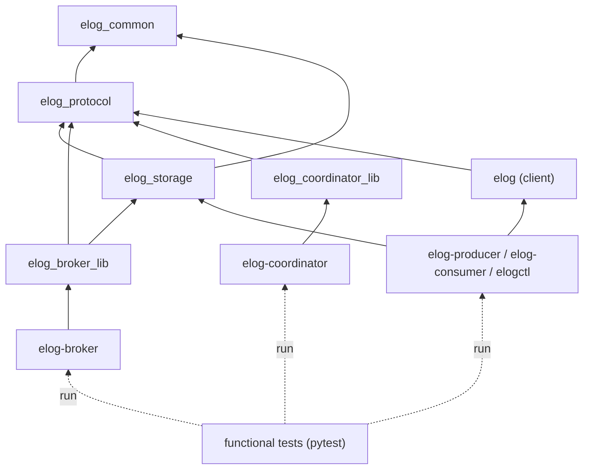
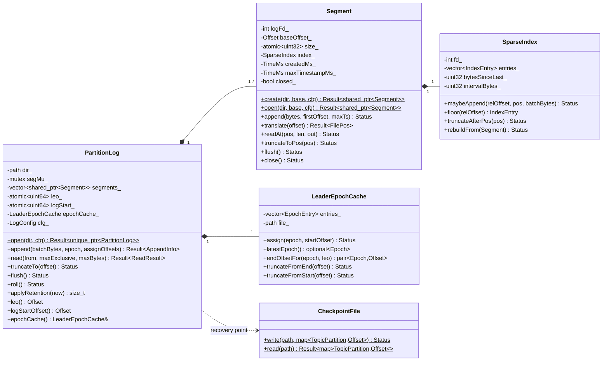
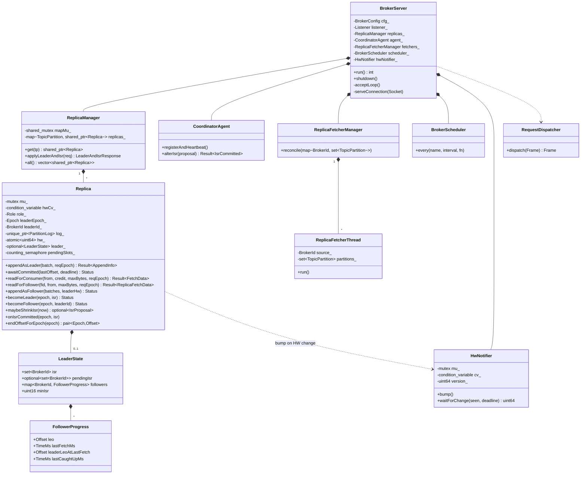
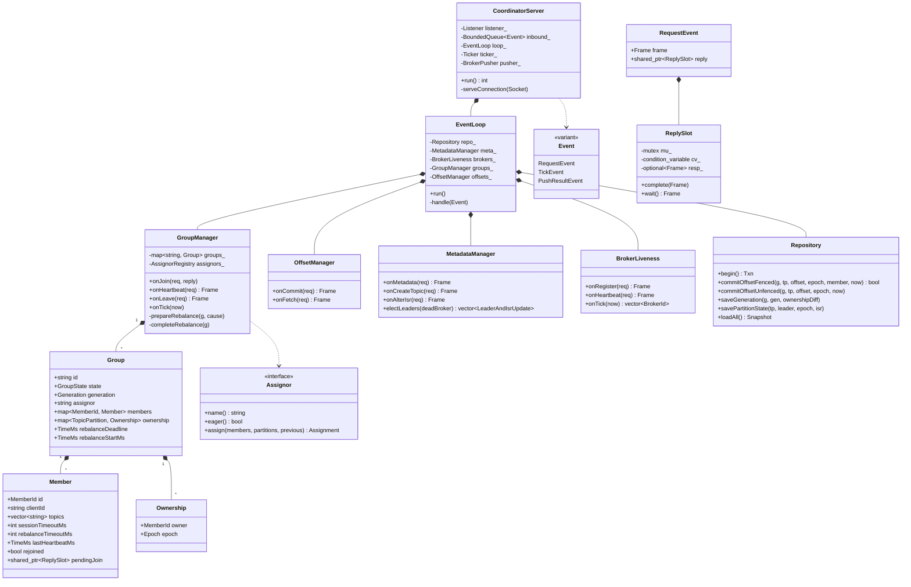
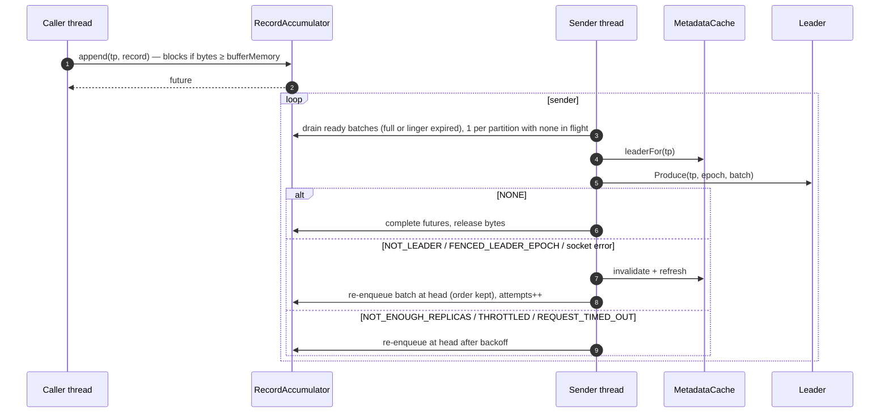
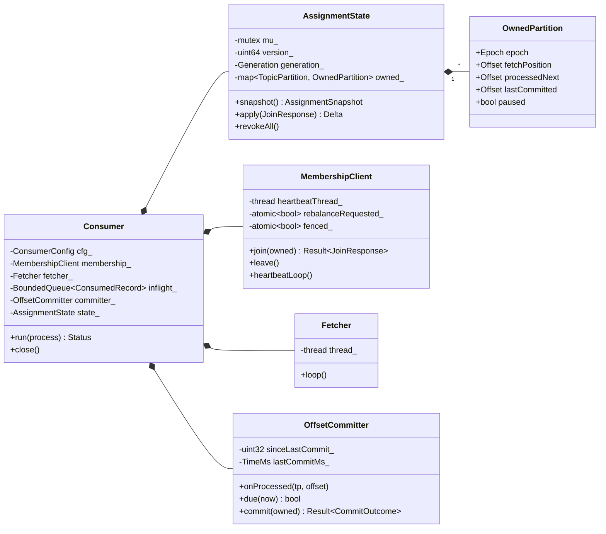

# Low-Level Design (LLD)

## Distributed Event Log with Dynamic Consumer Rebalancing

| Field | Value |
|---|---|
| Project | #49 — Distributed Event Log with Dynamic Consumer Rebalancing |
| Document type | Low-Level Design |
| Version | 1.3 |
| Status | Draft for review |
| Date | 2026-10-31 |
| Inputs | [requirements.md](requirements.md) (SRS v1.1), [high-level-design.md](high-level-design.md) (HLD v1.2) |

### Revision History

| Version | Date | Changes |
|---|---|---|
| 1.0 | 2026-10-28 | Initial draft |
| 1.1 | 2026-10-28 | Functional tests only (SRS v1.1): §15 rewritten as a functional test catalogue; GoogleTest/RapidCheck removed (§2); `Clock` interface replaced by time helpers (§3.2); `ELOG_TEST_HOOKS` and `OrderedMutex` removed (§14, §11.2); `elogctl describe-*`/`log-verify` and a read-only `DescribeGroup` request added for observability (§15.2). |
| 1.2 | 2026-10-29 | R-9: `ErrorCode` moves to `common` and gains the local-only `NETWORK_ERROR` (§2.1, §3.1, §4.4). |
| 1.3 | 2026-10-31 | R-10: broker `request.timeout.ms` (§12.1); reply to API keys a server does not handle (§6.2). |

---

## Table of Contents

1. [Introduction](#1-introduction)
2. [Source Tree and Build](#2-source-tree-and-build)
3. [Foundation Library (`common`)](#3-foundation-library-common)
4. [Wire Protocol (`protocol`)](#4-wire-protocol-protocol)
5. [Storage Engine (`storage`)](#5-storage-engine-storage)
6. [Broker](#6-broker)
7. [Group Coordinator](#7-group-coordinator)
8. [Coordinator Persistence (SQLite)](#8-coordinator-persistence-sqlite)
9. [Partition Assignors](#9-partition-assignors)
10. [Client Library (`libelog`)](#10-client-library-libelog)
11. [Concurrency, Locking and Thread Affinity](#11-concurrency-locking-and-thread-affinity)
12. [Configuration Catalogue](#12-configuration-catalogue)
13. [Observability: Metrics, Events and Logs](#13-observability-metrics-events-and-logs)
14. [Fault-Injection Hooks](#14-fault-injection-hooks)
15. [Test Design](#15-test-design)
16. [Experiment Harness](#16-experiment-harness)
17. [Refinements to the HLD](#17-refinements-to-the-hld)
18. [Traceability](#18-traceability)

---

## 1. Introduction

### 1.1 Purpose

This document turns the HLD into an implementable specification: source layout, C++ interfaces, thread affinity, byte-exact wire and disk formats, SQLite DDL, algorithm pseudocode, configuration and metric catalogues, and the test design. An engineer should be able to implement any component from this document and the HLD alone.

### 1.2 Conventions

- **Code** is C++20 sketches. Signatures are normative; bodies are illustrative.
- **Pseudocode** uses Python-like syntax. `←` means assignment inside algorithm blocks.
- **Integers** on the wire and on disk are **big-endian** unless stated otherwise.
- **Offsets** are `uint64_t`. Epochs and generations are `uint32_t`. Broker IDs are `int32_t`.
- **Diagrams** are UML in Mermaid, as in the HLD.
- **"MUST", "SHOULD", "MAY"** carry their RFC 2119 meanings.

### 1.3 Resolved HLD Open Issues

| HLD ref | Resolution in this LLD |
|---|---|
| OI-1 Partition hash | MurmurHash3 x86_32, seed `0x9747b28c`, over raw key bytes ([§10.2](#102-partitioner)) |
| OI-2 Default timeouts | Session 6 000 ms, heartbeat 2 000 ms, rebalance 10 000 ms, replica lag 10 000 ms, broker session 6 000 ms ([§12](#12-configuration-catalogue)). Calibrate during E3. |

---

## 2. Source Tree and Build

### 2.1 Repository Layout

```
.
├── CMakeLists.txt
├── CMakePresets.json            # dev (ASan+UBSan), release, optional tsan
├── .clang-format
├── cmake/
│   ├── Dependencies.cmake       # FetchContent declarations (pinned)
│   ├── Sanitizers.cmake
│   └── Warnings.cmake           # -Wall -Wextra -Wpedantic -Werror (CI)
├── src/
│   ├── common/                  # target: elog_common
│   │   ├── include/elog/common/{types,error_code,result,time,config,logging,
│   │   │                         metrics,socket,crc32c,bytes,bounded_queue}.h
│   │   └── *.cc
│   ├── protocol/                # target: elog_protocol
│   │   ├── include/elog/protocol/{api_keys,error_codes,frame,messages,
│   │   │                           json_codec,msgpack_codec,record_batch}.h
│   │   └── *.cc
│   ├── storage/                 # target: elog_storage
│   │   ├── include/elog/storage/{segment,sparse_index,partition_log,
│   │   │                          checkpoint,leader_epoch_cache,recovery}.h
│   │   └── *.cc
│   ├── broker/                  # target: elog_broker_lib + exe elog-broker
│   ├── coordinator/             # target: elog_coordinator_lib + exe elog-coordinator
│   ├── client/                  # target: elog (public client library)
│   └── tools/                   # exes: elog-producer, elog-consumer, elogctl
├── tests/
│   └── functional/              # pytest scenarios that run the real binaries (§15)
├── deploy/
│   ├── docker/Dockerfile.build  # pinned GCC 13 + CMake 3.28
│   ├── docker/Dockerfile.runtime
│   └── compose.yaml
├── experiments/
│   ├── lib/                     # common.sh, faults.sh, run_meta.py
│   └── e1_steady_state.sh … e9_backlog_drain.sh
├── analysis/                    # pandas + matplotlib; plot_e1.py … plot_e9.py
└── docs/
```

### 2.2 CMake Targets



`storage` depends on `protocol` only for `RecordBatch` (shared wire/disk format, [§4.5](#45-record-batch-format)). `elogctl` links `storage` for the offline `log-verify` command. Functional tests are Python and only run the built binaries.

### 2.3 Pinned Dependencies

| Library | Version | Purpose | Notes |
|---|---|---|---|
| nlohmann/json | 3.11.3 | Control-plane codec | Header-only |
| msgpack-cxx | 6.1.1 | Record and data-plane codec | Built with `MSGPACK_NO_BOOST` |
| spdlog | 1.14.1 | Logging | `SPDLOG_FMT_EXTERNAL=OFF` |
| SQLite | 3.46.1 amalgamation | Coordinator store | Needs ≥ 3.24 for UPSERT. Built with `SQLITE_THREADSAFE=2`. |
| google/crc32c | 1.1.2 | CRC32C (hardware-accelerated) | |
| pytest (Python) | 8.x | Functional tests | Shares `analysis/` helpers |

MurmurHash3 is vendored as `src/common/murmur3.cc` (public domain, about 60 lines).

### 2.4 Build Presets

| Preset | Flags | Used by |
|---|---|---|
| `dev` | `-O1 -g -fsanitize=address,undefined -fno-omit-frame-pointer` | Local development |
| `tsan` | `-O1 -g -fsanitize=thread` | Optional: one functional-suite run before submission (NFR-CONC-01) |
| `release` | `-O2 -g -DNDEBUG` | Experiments |

---

## 3. Foundation Library (`common`)

### 3.1 Core Types and Result

```cpp
namespace elog {

using Offset     = std::uint64_t;
using Epoch      = std::uint32_t;   // leader epoch, ownership epoch
using Generation = std::uint32_t;
using BrokerId   = std::int32_t;
using MemberId   = std::string;
using TimeMs     = std::int64_t;    // milliseconds; monotonic or wall, see §3.2

struct TopicPartition {
    std::string topic;
    std::uint32_t partition;
    auto operator<=>(const TopicPartition&) const = default;
};

enum class ErrorCode : std::int16_t;   // values in common/error_code.h (§4.4, R-9)

// Minimal expected-like type (std::expected is C++23).
template <class T>
class Result {
public:
    Result(T value);
    Result(ErrorCode code, std::string message = {});
    bool ok() const noexcept;
    const T& value() const&;      T&& value() &&;
    ErrorCode error() const noexcept;
    const std::string& message() const noexcept;
};
using Status = Result<std::monostate>;

}  // namespace elog
```

`std::hash<TopicPartition>` is specialised. All maps keyed by partition are `std::map` (deterministic iteration, required by the assignors) unless a profile shows a hot spot.

### 3.2 Time Helpers

```cpp
namespace elog::time {
TimeMs monotonicMs();   // std::chrono::steady_clock — timeouts, deadlines, durations
TimeMs wallMs();        // std::chrono::system_clock — record and metric timestamps only
}
```

**Rule:** timeouts and deadlines always use `monotonicMs()`, never wall time, so a clock adjustment cannot cause false evictions.

### 3.3 Sockets and Framing

```cpp
class Socket {                                   // RAII over an fd
public:
    static Result<Socket> connect(const std::string& host, std::uint16_t port,
                                  std::chrono::milliseconds timeout);
    Status setTimeouts(std::chrono::milliseconds rcv, std::chrono::milliseconds snd);
    Status readExact(std::span<std::byte> out);  // loops over EINTR/short reads
    Status writeAll(std::span<const std::byte> in);
    void shutdown() noexcept;                    // unblocks a thread in read()
    ~Socket();                                   // close()
};

class Listener {
public:
    static Result<Listener> bind(const std::string& host, std::uint16_t port, int backlog = 128);
    Result<Socket> accept();                     // blocking
};

struct Frame {
    ApiKey apiKey;
    std::uint32_t correlationId;
    BodyEncoding encoding;                       // Json | MsgPack
    std::uint8_t flags;                          // bit0: isResponse
    std::vector<std::byte> body;
};

Result<Frame> readFrame(Socket&, std::size_t maxFrameBytes);   // validates magic, version, CRC
Status        writeFrame(Socket&, const Frame&);
```

### 3.4 Bounded Queue

Used for the coordinator inbound queue, the producer accumulator and the consumer in-flight queue.

```cpp
template <class T>
class BoundedQueue {
public:
    explicit BoundedQueue(std::size_t capacity);
    bool push(T item, std::chrono::milliseconds timeout);   // false on timeout or close
    std::optional<T> pop(std::chrono::milliseconds timeout);
    std::size_t size() const;
    std::size_t freeSlots() const;                          // capacity - size (credit)
    template <class Pred> std::size_t removeIf(Pred);       // revocation
    void close();                                           // wakes all waiters
private:
    mutable std::mutex mu_;
    std::condition_variable notFull_, notEmpty_;
    std::deque<T> items_;
    std::size_t capacity_;
    bool closed_ = false;
};
```

---

## 4. Wire Protocol (`protocol`)

### 4.1 Frame Layout

```
 0                   1                   2                   3
 0 1 2 3 4 5 6 7 8 9 0 1 2 3 4 5 6 7 8 9 0 1 2 3 4 5 6 7 8 9 0 1
+---------------------------------------------------------------+
|                    frameLength (u32)                          |  bytes after this field
+---------------+---------------+-------------------------------+
|  magic=0xE1   |  version=1    |          apiKey (u16)         |
+---------------+---------------+-------------------------------+
|                     correlationId (u32)                       |
+---------------+---------------+-------------------------------+
| encoding (u8) |  flags (u8)   |        reserved (u16) = 0     |
+---------------+---------------+-------------------------------+
|                         body ...                              |
+---------------------------------------------------------------+
|                    crc32c (u32) over [magic .. end of body]   |
+---------------------------------------------------------------+
```

| Field | Size | Values |
|---|---|---|
| `frameLength` | 4 | `12 + bodyLen + 4`. MUST be ≤ `max.frame.bytes` (default 8 MiB), checked **before** allocation. |
| `magic` | 1 | `0xE1`. A mismatch returns `CORRUPT_MESSAGE` and closes the connection. |
| `version` | 1 | Protocol version, `1`. Unknown returns `UNSUPPORTED_VERSION`. |
| `apiKey` | 2 | [§4.3](#43-api-catalogue) |
| `correlationId` | 4 | Chosen by the client, echoed in the response |
| `encoding` | 1 | `0` = JSON (UTF-8), `1` = MessagePack |
| `flags` | 1 | bit0 = response, bit1–7 reserved (0) |
| `crc32c` | 4 | Castagnoli CRC over the fixed header (excluding `frameLength`) and the body |

### 4.2 Request/Response Model

- Each connection carries **one outstanding request at a time** (no pipelining). This keeps thread-per-connection handlers simple and gives TCP backpressure for free ([§6.5](#65-produce-path)).
- A response has the same `apiKey` and `correlationId` as its request, with `flags.bit0 = 1`.
- Every response body contains a top-level `error` (int16). Per-partition operations also carry per-partition `error` fields.

### 4.3 API Catalogue

| Key | Name | Direction | Encoding | Handler |
|---|---|---|---|---|
| 1 | `Metadata` | Client/Broker → Coordinator | JSON | MetadataManager |
| 2 | `CreateTopic` | `elogctl` → Coordinator | JSON | MetadataManager |
| 3 | `RegisterBroker` | Broker → Coordinator | JSON | BrokerLiveness |
| 4 | `BrokerHeartbeat` | Broker → Coordinator | JSON | BrokerLiveness |
| 5 | `AlterIsr` | Leader → Coordinator | JSON | MetadataManager |
| 6 | `LeaderAndIsr` | Coordinator → Broker | JSON | LeaderAndIsrHandler |
| 10 | `Produce` | Producer → Leader | MsgPack | ProduceHandler |
| 11 | `Fetch` | Consumer → Leader | MsgPack | FetchHandler |
| 12 | `ReplicaFetch` | Follower → Leader | MsgPack | ReplicaFetchHandler |
| 13 | `OffsetsForLeaderEpoch` | Follower → Leader | JSON | OffsetsForLeaderEpochHandler |
| 20 | `JoinGroup` | Consumer → Coordinator | JSON | GroupManager |
| 21 | `Heartbeat` | Consumer → Coordinator | JSON | GroupManager |
| 22 | `LeaveGroup` | Consumer → Coordinator | JSON | GroupManager |
| 23 | `OffsetCommit` | Consumer → Coordinator | JSON | OffsetManager |
| 24 | `OffsetFetch` | Consumer → Coordinator | JSON | OffsetManager |
| 25 | `DescribeGroup` | `elogctl` → Coordinator | JSON | GroupManager (read-only) |

### 4.4 Error Codes

The enum lives in `common/error_code.h` so that `Result` and `Socket` can use it (R-9). Names and `isRetriable` live in `protocol/error_codes.h`.

| Code | Name | Retriable | Meaning |
|---|---|---|---|
| −1 | `NETWORK_ERROR` | Yes (reconnect) | **Local only, never sent on the wire.** Connect failed, peer closed, or socket timeout: the "transport error" of §6.8 and §10.7. |
| 0 | `NONE` | — | Success |
| 1 | `CORRUPT_MESSAGE` | Yes (reconnect) | Bad magic, CRC mismatch or truncated frame |
| 2 | `UNSUPPORTED_VERSION` | No | Unknown protocol version |
| 3 | `INVALID_REQUEST` | No | Schema violation, missing field |
| 4 | `UNKNOWN_TOPIC_OR_PARTITION` | Yes | Not (yet) known to the receiver |
| 5 | `NOT_LEADER` | Yes | Receiver is not the leader. The body MAY carry `leaderId`. |
| 6 | `STALE_EPOCH` | No | **Ownership-epoch fencing rejected an offset commit** (FR-OFF-03) |
| 7 | `FENCED_LEADER_EPOCH` | Yes | Request carries an older leader epoch than the receiver's |
| 8 | `UNKNOWN_MEMBER` | No | Member not in group. Rejoin with an empty member ID. |
| 9 | `ILLEGAL_GENERATION` | No | Heartbeat for a generation other than the current one. Rejoin. |
| 10 | `REBALANCE_IN_PROGRESS` | Yes | Commit, revoke and rejoin |
| 11 | `OFFSET_OUT_OF_RANGE` | No | Fetch offset outside `[logStart, LEO]` |
| 12 | `NOT_ENOUGH_REPLICAS` | Yes | \|ISR\| < `min.insync.replicas` |
| 13 | `THROTTLED` | Yes | Bounded resource full. Body carries `throttleMs`. |
| 14 | `REQUEST_TIMED_OUT` | Yes | Produce not committed within `request.timeout.ms` |
| 15 | `INVALID_PARTITION_COUNT` | No | Topic exists with a different partition count (FR-PART-06) |
| 16 | `STALE_BROKER_INCARNATION` | No | Broker message from a pre-restart incarnation |
| 99 | `UNKNOWN_SERVER_ERROR` | No | Bug; logged at error level with context |

### 4.5 Record Batch Format

The same byte layout is used **on the wire and on disk**, so the leader appends what it received after stamping two fields.

```
offset  size  field               written by     notes
------  ----  ------------------  -------------  -------------------------------------
0       8     baseOffset (u64)    leader         producer sends 0
8       4     batchLength (u32)   producer       bytes after this field
12      4     leaderEpoch (u32)   leader         producer sends 0
16      1     magic = 1           producer
17      4     crc32c (u32)        producer       CRC over bytes [21, end)
21      2     attributes (u16)    producer       all bits reserved = 0 (no compression)
23      4     lastOffsetDelta     producer       = recordCount - 1
27      8     firstTimestampMs    producer       wall clock
35      8     maxTimestampMs      producer
43      4     recordCount (u32)   producer       ≥ 1
47      …     records             producer       recordCount × MessagePack record
```

- **Header size** is 47 bytes. `RECORD_BATCH_OVERHEAD = 12` (`baseOffset` + `batchLength`).
- **The CRC excludes** `baseOffset`, `batchLength`, `leaderEpoch`, `magic` and the CRC itself. The leader can then stamp offset and epoch without recomputing it.
- **Record encoding.** Each record is a MessagePack array of 4 elements:

```
[ offsetDelta : uint, timestampDelta : int, key : bin | nil, value : bin ]
```

- **Application value** written by `elog-producer` (used for analysis):

```
value = msgpack map { "pid": str, "seq": uint, "ts": int(wall ms), "pad": bin(payload.bytes) }
```

```cpp
class RecordBatchView {                         // non-owning view over validated bytes
public:
    static Result<RecordBatchView> parse(std::span<const std::byte>);   // checks magic, length, CRC
    Offset baseOffset() const;  Offset lastOffset() const;
    Epoch leaderEpoch() const;  std::uint32_t recordCount() const;
    std::span<const std::byte> bytes() const;
    void forEachRecord(std::function<void(const Record&)>) const;
};

class RecordBatchBuilder {
public:
    void add(std::optional<std::span<const std::byte>> key,
             std::span<const std::byte> value, TimeMs ts);
    std::size_t estimatedBytes() const;
    std::uint32_t count() const;
    std::vector<std::byte> build() const;        // computes CRC
};

// Mutates header in place: baseOffset and leaderEpoch (CRC unaffected).
void stampBatch(std::span<std::byte> batch, Offset base, Epoch epoch);

// Re-encodes records [from, from+maxRecords) of `src` into a new batch with
// correct baseOffset/lastOffsetDelta and a recomputed CRC. Used by FetchHandler
// to honour credit exactly (§6.6).
std::vector<std::byte> sliceBatch(const RecordBatchView& src, Offset from, std::uint32_t maxRecords);
```

### 4.6 Message Schemas

Control-plane messages are JSON objects. Data-plane messages are MessagePack maps with the **same field names**. Records travel as `bin` holding concatenated record batches. Optional fields are marked `?`.

#### Metadata (1)

```jsonc
// request
{ "topics": ["orders"] }                         // empty = all
// response
{ "error": 0,
  "brokers": [ { "id": 1, "host": "broker-1", "port": 9101 } ],
  "topics": [ { "name": "orders", "error": 0,
                "partitions": [ { "partition": 0, "leader": 1, "leaderEpoch": 7,
                                  "replicas": [1,2,3], "isr": [1,2,3] } ] } ] }
```

#### CreateTopic (2)

```jsonc
{ "name": "orders", "partitions": 12, "replicationFactor": 3, "minIsr": 2 }
→ { "error": 0 }        // idempotent: same spec → NONE; different partitions → INVALID_PARTITION_COUNT
```

#### RegisterBroker (3) / BrokerHeartbeat (4)

```jsonc
{ "brokerId": 1, "host": "broker-1", "port": 9101 }   → { "error": 0, "incarnation": 12 }
{ "brokerId": 1, "incarnation": 12 }                    → { "error": 0 }
```

#### AlterIsr (5)

```jsonc
{ "brokerId": 1, "incarnation": 12, "topic": "orders", "partition": 0,
  "leaderEpoch": 7, "newIsr": [1, 3] }
→ { "error": 0, "isr": [1, 3] }          // FENCED_LEADER_EPOCH if epoch stale
```

#### LeaderAndIsr (6)

```jsonc
{ "controllerIncarnation": 4,
  "partitions": [ { "topic": "orders", "partition": 0, "leader": 2, "leaderEpoch": 8,
                    "isr": [2, 3], "replicas": [1, 2, 3] } ],
  "brokers": [ { "id": 2, "host": "broker-2", "port": 9102 } ] }
→ { "error": 0, "partitions": [ { "topic": "orders", "partition": 0, "error": 0 } ] }
```

#### Produce (10) — MessagePack

```jsonc
{ "timeoutMs": 30000,
  "partitions": [ { "topic": "orders", "partition": 3, "leaderEpoch": 7,
                    "records": <bin: one RecordBatch> } ] }
→ { "error": 0,
    "partitions": [ { "topic": "orders", "partition": 3, "error": 0,
                      "baseOffset": 41200, "throttleMs?": 0 } ] }
```

The producer sends **one batch per partition per request** and keeps **at most one in-flight request per connection**. This preserves per-partition order across retries (INV-01).

#### Fetch (11) — MessagePack

```jsonc
{ "maxWaitMs": 500, "maxBytes": 1048576, "credit": 512,
  "partitions": [ { "topic": "orders", "partition": 3, "fetchOffset": 41000,
                    "currentLeaderEpoch": 7 } ] }
→ { "error": 0,
    "partitions": [ { "topic": "orders", "partition": 3, "error": 0,
                      "highWatermark": 41300, "logStartOffset": 0,
                      "records": <bin: 0..n RecordBatches, total records ≤ credit> } ] }
```

#### ReplicaFetch (12) — MessagePack

```jsonc
{ "replicaId": 2, "maxWaitMs": 500, "maxBytes": 4194304,
  "partitions": [ { "topic": "orders", "partition": 3, "fetchOffset": 41250,
                    "currentLeaderEpoch": 7 } ] }
→ { "error": 0,
    "partitions": [ { "topic": "orders", "partition": 3, "error": 0,
                      "highWatermark": 41200, "leaderLeo": 41300,
                      "records": <bin: whole batches> } ] }
```

`fetchOffset` is the follower's LEO. It doubles as the **acknowledgement** of everything below it.

#### OffsetsForLeaderEpoch (13)

```jsonc
{ "partitions": [ { "topic": "orders", "partition": 3, "leaderEpoch": 6 } ] }
→ { "error": 0, "partitions": [ { "topic": "orders", "partition": 3, "error": 0,
                                  "leaderEpoch": 6, "endOffset": 41180 } ] }
```

#### JoinGroup (20)

```jsonc
{ "groupId": "g1", "memberId": "",               // "" on first join
  "clientId": "consumer-3", "topics": ["orders"],
  "sessionTimeoutMs": 6000, "rebalanceTimeoutMs": 10000,
  "owned": [ { "topic": "orders", "partition": 3, "epoch": 5 } ] }   // informational
→ { "error": 0, "memberId": "consumer-3-6f1c…", "generation": 6, "assignor": "sticky",
    "assignment": [ { "topic": "orders", "partition": 3, "epoch": 5 },
                    { "topic": "orders", "partition": 7, "epoch": 6 } ] }
```

#### Heartbeat (21) / LeaveGroup (22)

```jsonc
{ "groupId": "g1", "memberId": "consumer-3-6f1c…", "generation": 6 }
→ { "error": 0 }        // or REBALANCE_IN_PROGRESS / ILLEGAL_GENERATION / UNKNOWN_MEMBER
{ "groupId": "g1", "memberId": "consumer-3-6f1c…" } → { "error": 0 }
```

#### OffsetCommit (23)

```jsonc
{ "groupId": "g1", "memberId": "consumer-3-6f1c…",
  "offsets": [ { "topic": "orders", "partition": 3, "offset": 41250, "epoch": 5 } ] }
→ { "error": 0,
    "offsets": [ { "topic": "orders", "partition": 3, "error": 0 } ] }   // per-partition STALE_EPOCH
```

#### OffsetFetch (24)

```jsonc
{ "groupId": "g1", "partitions": [ { "topic": "orders", "partition": 3 } ] }
→ { "error": 0, "offsets": [ { "topic": "orders", "partition": 3,
                               "offset": 41250, "error": 0 } ] }       // offset -1 = none
```

#### DescribeGroup (25) — read-only, for `elogctl` and tests

```jsonc
{ "groupId": "g1" }
→ { "error": 0, "state": "Stable", "generation": 6, "assignor": "sticky",
    "members": [ { "memberId": "consumer-3-6f1c…", "clientId": "consumer-3" } ],
    "partitions": [ { "topic": "orders", "partition": 3, "owner": "consumer-3-6f1c…",
                      "epoch": 5, "committedOffset": 41250 } ] }
```

### 4.7 Codec Interfaces

```cpp
// One struct per message in messages.h, e.g.:
struct OffsetCommitRequest {
    std::string groupId; MemberId memberId;
    struct Entry { TopicPartition tp; Offset offset; Epoch epoch; };
    std::vector<Entry> offsets;
};
// Codecs are free functions, generated per message with a small macro or hand-written:
Result<OffsetCommitRequest> decodeOffsetCommitRequest(const Frame&);
Frame encode(const OffsetCommitResponse&, std::uint32_t correlationId);
```

Decoders MUST reject unknown required-field types, negative values in unsigned fields, and arrays longer than `max.request.entries` (default 10 000) with `INVALID_REQUEST`.

---

## 5. Storage Engine (`storage`)

### 5.1 Class Model



### 5.2 File Formats

#### 5.2.1 Segment `.log`

A plain concatenation of record batches ([§4.5](#45-record-batch-format)). There is no file header. File name: `%020llu.log` of the base offset.

#### 5.2.2 Sparse Index `.index`

```
repeated:  relativeOffset (u32, BE) | position (u32, BE)       // 8 bytes per entry
```

- An entry is appended **before** a batch when `bytesSinceLast ≥ index.interval.bytes` (default 4 096), and always for the first batch of a segment.
- Entries are strictly increasing in both fields. `relativeOffset = batch.baseOffset − segment.baseOffset`.
- `segment.bytes` ≤ 2³¹ guarantees that `position` fits in a u32. Config validation enforces this.
- The whole index is mirrored in memory (`std::vector<IndexEntry>`). It is small because it is sparse: 64 MiB / 4 KiB × 8 B = 128 KiB worst case.

#### 5.2.3 Checkpoint Files

`recovery-point.checkpoint`, `high-watermark.checkpoint` — text, one line per partition:

```
0                         ← format version
3                         ← entry count
orders 0 41200
orders 1 39877
orders 2 40510
```

`<topic>-<partition>/leader-epoch.checkpoint`:

```
0
2
6 0          ← epoch 6 started at offset 0
7 41180      ← epoch 7 started at offset 41180
```

**Atomic write procedure** (all checkpoints): write `<file>.tmp`, then `fsync(tmp)`, then `rename(tmp, file)`, then `fsync(dir)`.

#### 5.2.4 `meta.properties`

```
version=1
broker.id=1
```

If the broker ID on disk differs from the configured one at startup, the broker aborts with a fatal error (guards against mixed-up data directories).

### 5.3 Append Algorithm

```python
def append(batch_bytes, epoch, assign_offsets=True):        # caller holds Replica::mu_
    view = RecordBatchView.parse(batch_bytes)                # CRC check (FR-LOG-07)
    if assign_offsets:                                       # leader path
        base ← leo_
        stampBatch(batch_bytes, base, epoch)
    else:                                                    # follower path
        require view.baseOffset == leo_                      # else INVALID_REQUEST (gap)
    active ← segments_.back()
    if should_roll(active, len(batch_bytes)):
        roll()                                               # new segment, base = leo_
        active ← segments_.back()
    if epochCache.latestEpoch() != view.leaderEpoch:
        epochCache.assign(view.leaderEpoch, view.baseOffset)
    active.index.maybeAppend(view.baseOffset - active.base, active.size, len(batch_bytes))
    pwrite(active.logFd, batch_bytes, active.size)           # full write or error
    active.size += len(batch_bytes)
    active.maxTimestampMs = max(active.maxTimestampMs, view.maxTimestampMs)
    leo_.store(view.lastOffset + 1, release)
    if cfg.flushPolicy == PER_BATCH: active.flush()          # fdatasync
    return AppendInfo(base=view.baseOffset, last=view.lastOffset)

def should_roll(active, n):
    return active.size > 0 and (active.size + n > cfg.segmentBytes
                                or time.monotonicMs() - active.createdMs >= cfg.segmentMs)
```

### 5.4 Read Algorithm

```python
def read(from_offset, max_exclusive, max_bytes) -> ReadResult:
    if from_offset < logStart_ or from_offset > leo_: return OFFSET_OUT_OF_RANGE
    with segMu_: segs ← snapshot of shared_ptrs           # O(#segments) copy, then unlock
    seg ← last s in segs with s.base ≤ from_offset          # binary search
    pos ← seg.index.floor(from_offset - seg.base).position
    out ← []; first_batch_seen ← False
    while seg is not None:
        while pos < seg.size:
            hdr ← seg.readAt(pos, 12)                       # baseOffset + batchLength
            batch_base, blen ← decode(hdr)
            if batch_base >= max_exclusive: return out
            total ← 12 + blen
            last ← batch_base + lastOffsetDelta(seg, pos)
            if last < from_offset: pos += total; continue   # skip to target batch
            if out and len(out) + total > max_bytes: return out
            out += seg.readAt(pos, total)                   # always ≥ 1 batch if any
            pos += total
        seg ← next segment in segs; pos ← 0
    return out
```

- Reads hold **no lock** while doing I/O. They work from a snapshot of `shared_ptr<Segment>`. Retention may unlink a file while a reader still holds its fd; Linux keeps the inode alive.
- Callers bound reads: **consumers** by `HW`, **followers** by `LEO`. `max_exclusive` never exceeds `leo_` loaded with `acquire`, so a read never sees a partially written batch.

### 5.5 Truncation

```python
def truncateTo(offset):                                     # caller holds Replica::mu_
    if offset >= leo_: return
    require offset >= hw_checkpointed_floor                 # never truncate committed data
    with segMu_:
        drop (close + unlink) every segment with base ≥ offset, except keep at least one
    seg ← segment containing offset
    pos ← byte position of the first batch with baseOffset ≥ offset    # scan from index floor
    seg.truncateToPos(pos)                                   # ftruncate + fsync
    seg.index.truncateAfterPos(pos)
    epochCache.truncateFromEnd(offset)
    leo_.store(offset)
```

Truncation always happens on a **batch boundary**. Followers only ever have whole batches, and leader-epoch end offsets are batch boundaries.

### 5.6 Startup Recovery (FR-LOG-08)

```python
def open(dir):
    segs ← sorted .log files by base offset
    delete orphan .index without .log; delete *.tmp
    if not segs: create segment 0
    rp ← recovery_point.get(tp, 0)
    for seg in segs:
        load index; if index invalid (size % 8 ≠ 0, non-monotonic, pos > logSize):
            seg.index.rebuildFrom(seg)
    for seg in segs where seg.base ≥ floor_segment(rp).base:      # unflushed region only
        pos ← 0
        while pos < seg.size:
            if seg.size - pos < 12: break
            read header; if batchLength out of range: break
            read batch; if RecordBatchView.parse fails (CRC/magic): break
            pos += 12 + batchLength
        if pos < seg.size:
            log.warn("truncating torn tail", seg, pos, seg.size)
            seg.truncateToPos(pos); seg.index.truncateAfterPos(pos)
            delete all later segments; break
    leo_ ← last valid batch lastOffset + 1 (or segs.back().base if empty)
    epochCache.load(); epochCache.truncateFromEnd(leo_)
    logStart_ ← segs.front().base
```

### 5.7 Retention

The broker scheduler runs `applyRetention(now)` every `retention.check.interval.ms` (default 30 s). It only considers **closed** segments, oldest first, and stops at the first segment that survives.

```python
while len(segments_) > 1:
    oldest ← segments_[0]
    by_size ← cfg.retentionBytes >= 0 and totalSize() - oldest.size >= cfg.retentionBytes
    by_time ← cfg.retentionMs >= 0 and now - oldest.maxTimestampMs > cfg.retentionMs
    if not (by_size or by_time): break
    remove from segments_ (under segMu_), logStart_ ← segments_[0].base, unlink files
    epochCache.truncateFromStart(logStart_)
```

### 5.8 Flush Policies

| `log.flush.policy` | Behaviour | Durability on power loss |
|---|---|---|
| `batch` | `fdatasync` after every append (leader and follower) | Every acked record is on ≥ minISR disks |
| `interval` (default) | Scheduler fsyncs dirty segments every `log.flush.interval.ms` (1 000) | Durability relies on replication (a single process crash loses nothing) |
| `none` | OS decides | Testing only |

After every successful flush the recovery point advances to `leo` at flush time. The checkpoint file is written every `recovery.checkpoint.interval.ms` (5 000).

---

## 6. Broker

### 6.1 Class Model



### 6.2 Connection Handling

```python
def acceptLoop():
    while running:
        sock ← listener.accept()
        if active_connections >= cfg.maxConnections:      # default 256
            sock.close(); metric conn_rejected++; continue
        spawn detached thread serveConnection(sock)      # tracked in a registry for shutdown

def serveConnection(sock):
    sock.setTimeouts(rcv=cfg.connectionIdleMs, snd=cfg.requestTimeoutMs)
    while running:
        frame ← readFrame(sock, cfg.maxFrameBytes)
        if error: log; break                             # CORRUPT_MESSAGE → close (NFR-SEC-02)
        resp ← dispatcher.dispatch(frame)                # may block (produce/fetch/long-poll)
        writeFrame(sock, resp)
```

A well-formed frame whose API key this server does not handle gets a response with the same `apiKey` and `correlationId` whose body holds only `error = INVALID_REQUEST`, in the request's encoding. The connection stays open, since the frame itself was valid (R-10).

Shutdown: set `running=false`, `listener.close()`, `shutdown()` every registered socket, join all threads, flush logs, write checkpoints.

### 6.3 Replica Role Transitions (`LeaderAndIsr`)

```python
def applyLeaderAndIsr(req):
    for p in req.partitions:
        r ← replicas_.getOrCreate(p.tp)                   # opens/recovers log on first use
        with r.mu_:
            if p.leaderEpoch < r.leaderEpoch_: result FENCED_LEADER_EPOCH; continue
            if p.leaderEpoch == r.leaderEpoch_ and r.role_ matches: continue     # idempotent
            if p.leader == self.id: r.becomeLeader(p.leaderEpoch, p.isr)
            else:                   r.becomeFollower(p.leaderEpoch, p.leader)
    fetchers_.reconcile(followed partitions grouped by leader)
    hwNotifier_.bump()                                    # wakes waiters to re-check role

def becomeLeader(epoch, isr):                             # holds mu_
    leaderEpoch_ ← epoch; role_ ← LEADER
    log_.epochCache().assign(epoch, log_.leo())
    leader_ ← LeaderState(isr=isr, followers={f: FollowerProgress(leo=0, lastCaughtUpMs=now)
                                               for f in replicas if f ≠ self})
    hwCv_.notify_all()                                    # fail parked produces from old role

def becomeFollower(epoch, leaderId):                      # holds mu_
    leaderEpoch_ ← epoch; leaderId_ ← leaderId; role_ ← FOLLOWER
    leader_ ← None; state ← TRUNCATING                    # fetcher performs §6.8 before fetching
    hwCv_.notify_all()
```

### 6.4 High-Watermark Maintenance (leader)

```python
def maybeAdvanceHw():                                     # holds mu_; called after any LEO change
    effective_isr ← leader_.isr ∪ (leader_.pendingIsr or ∅)      # "maximal ISR" while change in flight
    if len(leader_.isr) < leader_.minIsr: return          # nothing commits below minISR (ADR-03)
    leos ← [log_.leo()] + [leader_.followers[f].leo for f in effective_isr if f ≠ self]
    new_hw ← min(leos)
    if new_hw > hw_:
        hw_.store(new_hw, release)
        hwCv_.notify_all(); hwNotifier.bump()
```

Using the **union** of the current and the pending ISR means a shrink cannot advance HW past the follower being removed until the coordinator has persisted the shrink (HLD §9.9). An expansion is safe because the joining follower already has `leo ≥ hw`.

### 6.5 Produce Path

```python
def handleProduce(req):
    resp ← []
    for p in req.partitions:                               # one partition per request is typical
        r ← replicas_.get(p.tp) or UNKNOWN_TOPIC_OR_PARTITION
        # 1. bounded admission (FR-BP-04): blocks this connection thread → TCP backpressure
        if not r.pendingSlots_.try_acquire_for(cfg.produceAdmissionWaitMs):   # default 5 000
            resp += THROTTLED(throttleMs=cfg.throttleHintMs); continue
        guard ← release slot on scope exit
        with r.mu_:
            if r.role_ != LEADER:                  resp += NOT_LEADER(leaderId_); continue
            if p.leaderEpoch < r.leaderEpoch_:     resp += NOT_LEADER(self); continue   # stale metadata
            if p.leaderEpoch > r.leaderEpoch_:     resp += FENCED_LEADER_EPOCH; continue
            if len(r.leader_.isr) < r.leader_.minIsr: resp += NOT_ENOUGH_REPLICAS; continue
            info ← r.log_.append(p.records, r.leaderEpoch_, assign_offsets=True)
            r.maybeAdvanceHw()                     # R=1 or followers already ahead
            epoch_at_append ← r.leaderEpoch_
        # 2. wait for commit (FR-PROD-03)
        st ← r.awaitCommitted(info.last, deadline=now + req.timeoutMs, epoch_at_append)
        resp += st.ok ? NONE(baseOffset=info.base) : st.error   # REQUEST_TIMED_OUT / NOT_LEADER
    return resp

def awaitCommitted(last, deadline, epoch):                # waits on hwCv_ with mu_
    with mu_:
        hwCv_.wait_until(deadline, lambda: hw_ > last or leaderEpoch_ != epoch or role_ != LEADER)
        if hw_ > last: return OK
        if leaderEpoch_ != epoch or role_ != LEADER: return NOT_LEADER
        return REQUEST_TIMED_OUT
```

`pendingSlots_` is a `std::counting_semaphore<>` sized `max.pending.produce` (default 64) per partition. If a leader loses leadership while requests are parked, they fail with `NOT_LEADER`. The producer retries against the new leader, which can duplicate records (accepted under at-least-once).

### 6.6 Consumer Fetch Path (credit-exact)

```python
def handleFetch(req):
    deadline ← now + min(req.maxWaitMs, cfg.fetchMaxWaitMs)
    seen ← hwNotifier.version()
    loop:
        credit ← req.credit; bytes_left ← min(req.maxBytes, cfg.fetchMaxBytes)
        out ← []; total_records ← 0
        for p in req.partitions:
            r ← replicas_.get(p.tp); validate LEADER and epoch (as produce)
            hw ← r.hw_.load(acquire)
            if p.fetchOffset > hw or p.fetchOffset < r.log_.logStartOffset():
                out += OFFSET_OUT_OF_RANGE; continue
            if credit == 0 or bytes_left == 0 or p.fetchOffset == hw:
                out += empty(hw); continue
            raw ← r.log_.read(p.fetchOffset, max_exclusive=hw, max_bytes=bytes_left)
            batches ← []
            for b in RecordBatchView.iterate(raw):
                lo ← max(b.base, p.fetchOffset); hi ← min(b.last + 1, hw)
                n ← min(hi - lo, credit)
                if n <= 0: continue
                if lo == b.base and n == b.count: batches += b.bytes         # whole batch, zero-copy
                else:                             batches += sliceBatch(b, lo, n)
                credit -= n; total_records += n
                if credit == 0: break
            bytes_left -= size(batches)
            out += data(hw, batches)
        if total_records > 0 or now >= deadline: return out
        seen ← hwNotifier.waitForChange(seen, deadline)    # long-poll (FR-FETCH-06)
```

- **Credit invariant:** `Σ records returned ≤ req.credit` (FR-FETCH-04). It is enforced by slicing boundary batches. Slicing only happens on the first batch (unaligned `fetchOffset`) and the last batch (credit boundary), so most data is passed through unchanged.
- **Committed-only:** reads are bounded by `hw` (INV-07).
- **Fairness:** the client rotates partition order on each request ([§10.5](#105-fetcher)).

### 6.7 Replica Fetch Path (leader side)

```python
def handleReplicaFetch(req):
    for p in req.partitions:
        r ← replicas_.get(p.tp)
        with r.mu_:
            validate LEADER and p.currentLeaderEpoch == r.leaderEpoch_ (else FENCED_LEADER_EPOCH)
            f ← r.leader_.followers[req.replicaId]
            leo ← r.log_.leo()
            # 1. ack: fetchOffset == follower LEO
            if p.fetchOffset > leo: error OFFSET_OUT_OF_RANGE      # follower must truncate
            if p.fetchOffset >= f.leaderLeoAtLastFetch: f.lastCaughtUpMs ← f.lastFetchMs
            if p.fetchOffset >= leo:                    f.lastCaughtUpMs ← now
            f.leo ← p.fetchOffset; f.lastFetchMs ← now; f.leaderLeoAtLastFetch ← leo
            r.maybeAdvanceHw()
            expand ← r.maybeExpandIsr(req.replicaId)              # proposal or None
        if expand: agent_.alterIsrAsync(expand)
        data ← r.log_.read(p.fetchOffset, max_exclusive=leo, max_bytes=…)   # whole batches
    if no data anywhere and now < deadline: hwNotifier.waitForChange(…)      # long-poll; LEO bumps notify
    return data with highWatermark=hw, leaderLeo=leo
```

**ISR expansion** (`maybeExpandIsr`): if `f ∉ isr`, `f.leo ≥ hw_`, `f.leo ≥ epochCache.startOffsetOf(leaderEpoch_)`, and no change is pending, then propose `isr ∪ {f}`.

**ISR shrink** (scheduler, every `replica.lag.time.max.ms / 2`):

```python
def maybeShrinkIsr(now):                                   # holds mu_
    if role_ != LEADER or leader_.pendingIsr: return None
    lagging ← {f ∈ isr, f ≠ self : now - followers[f].lastCaughtUpMs > cfg.replicaLagTimeMaxMs}
    if not lagging: return None
    leader_.pendingIsr ← isr \ lagging
    return IsrProposal(tp, leaderEpoch_, isr \ lagging)
```

`CoordinatorAgent::alterIsr` sends `AlterIsr`. On success it calls `onIsrCommitted(epoch, isr)`, which sets `isr ← committed`, clears `pendingIsr` and calls `maybeAdvanceHw()`. On `FENCED_LEADER_EPOCH` it clears `pendingIsr`; a `LeaderAndIsr` will follow. On a transport error it retries with backoff and `pendingIsr` stays set. Expansion is applied the same way.

### 6.8 Follower Fetcher and Truncation

```python
class ReplicaFetcherThread:                                # one per source leader
    def run():
        conn ← connect(source)
        while running:
            for tp in partitions where state == TRUNCATING: truncate(tp)
            req ← ReplicaFetch(replicaId=self, maxWaitMs=500,
                               partitions=[(tp, r.log_.leo(), r.leaderEpoch_) for FETCHING tp])
            resp ← conn.call(req)                          # on error: backoff, reconnect
            for p in resp.partitions:
                r ← replicas_.get(p.tp)
                if p.error == FENCED_LEADER_EPOCH: await LeaderAndIsr (state unchanged); continue
                if p.error == OFFSET_OUT_OF_RANGE: r.state ← TRUNCATING; continue
                with r.mu_:
                    for batch in p.records: r.log_.append(batch, assign_offsets=False)
                    r.hw_ ← min(p.highWatermark, r.log_.leo())
                    if flushPolicy == batch: r.log_.flush()           # before next fetch acks it

    def truncate(tp):                                      # leader-epoch based (ADR-10)
        r ← replicas_.get(tp)
        loop:
            e ← r.log_.epochCache().latestEpoch()
            if e is None: r.log_.truncateTo(r.hw_); break
            (le, end) ← conn.call(OffsetsForLeaderEpoch(tp, e))
            if le == e: r.log_.truncateTo(min(end, r.log_.leo())); break
            r.log_.epochCache().truncateFromEnd(end)      # drop epochs the leader never had
            r.log_.truncateTo(min(end, r.log_.leo()))     # then retry with the earlier epoch
        r.state ← FETCHING
```

**Leader side** of `OffsetsForLeaderEpoch(e)`: `le` is the largest epoch in the cache that is ≤ `e`. `end` is the start offset of the first epoch > `le`, or `LEO` if `le` is the latest epoch.

### 6.9 Coordinator Agent

| Task | Behaviour |
|---|---|
| Register | On start: `RegisterBroker` and store the `incarnation`. Retry with exponential backoff (100 ms → 5 s) until it succeeds. The broker serves nothing until it receives its first `LeaderAndIsr`. |
| Heartbeat | Every `broker.heartbeat.interval.ms` (2 000). `STALE_BROKER_INCARNATION` → re-register. |
| AlterIsr | Serialised per partition. At most one outstanding proposal per partition. |
| LeaderAndIsr intake | The coordinator connects **to the broker's listener** and sends `LeaderAndIsr` like any client, so it needs no special channel. |

### 6.10 Scheduler Jobs

| Job | Interval (config) | Action |
|---|---|---|
| ISR shrink check | `replica.lag.time.max.ms / 2` | `maybeShrinkIsr` for every leader replica, send proposals |
| Flush | `log.flush.interval.ms` (policy `interval`) | `flush()` dirty logs, advance the recovery point |
| HW checkpoint | `hw.checkpoint.interval.ms` (5 000) | Write `high-watermark.checkpoint` |
| Recovery-point checkpoint | `recovery.checkpoint.interval.ms` (5 000) | Write `recovery-point.checkpoint` |
| Retention | `retention.check.interval.ms` (30 000) | `applyRetention` |
| Segment roll by time | 1 000 | Roll active segments older than `segment.ms` |
| Metrics flush | `metrics.flush.interval.ms` (1 000) | Snapshot gauges to CSV |

---

## 7. Group Coordinator

### 7.1 Class Model



### 7.2 Event Loop

```python
def serveConnection(sock):                                 # connection thread: I/O only
    while running:
        frame ← readFrame(sock)
        slot ← ReplySlot()
        if not inbound_.push(RequestEvent(frame, slot), timeout=cfg.queueAdmissionMs):
            writeFrame(sock, error(THROTTLED)); continue
        writeFrame(sock, slot.wait())                      # JoinGroup may wait for a whole rebalance

def EventLoop.run():                                       # THE single state-owning thread
    while running:
        ev ← inbound_.pop()
        try: handle(ev)
        except Exception as e:
            log.error(...); if ev is RequestEvent and not ev.reply.done: ev.reply.complete(UNKNOWN_SERVER_ERROR)

def handle(ev):
    match ev:
        RequestEvent(JoinGroup)      → groups_.onJoin(req, ev.reply)        # may defer reply
        RequestEvent(Heartbeat)      → ev.reply.complete(groups_.onHeartbeat(req))
        RequestEvent(LeaveGroup)     → ev.reply.complete(groups_.onLeave(req))
        RequestEvent(OffsetCommit)   → ev.reply.complete(offsets_.onCommit(req))
        RequestEvent(OffsetFetch)    → ev.reply.complete(offsets_.onFetch(req))
        RequestEvent(Metadata|CreateTopic|AlterIsr) → ev.reply.complete(meta_.on…(req))
        RequestEvent(RegisterBroker|BrokerHeartbeat) → ev.reply.complete(brokers_.on…(req))
        TickEvent(now)               → dead ← brokers_.onTick(now)
                                       for b in dead: pusher_.enqueue(meta_.electLeaders(b))
                                       groups_.onTick(now)
        PushResultEvent(r)           → retry failed LeaderAndIsr deliveries
```

- **Ticker:** enqueues `TickEvent(time::monotonicMs())` every `coordinator.tick.ms` (default 100 ms). It uses a dedicated reserved slot, so ticks never block behind a full queue. This bounds detection latency to `timeout + tick`.
- **BrokerPusher:** a separate thread sends `LeaderAndIsr` to brokers. It **never touches state**. Results come back as `PushResultEvent`. Pushes are idempotent (epoch-checked), so retries are safe.

### 7.3 Group Membership and Rebalance

```python
def onJoin(req, reply):
    g ← groups_.getOrCreate(req.groupId, assignor=cfg.defaultAssignor)   # persisted on creation
    if req.memberId == "":
        m ← Member(id=f"{req.clientId}-{uuid4()}", ...); g.members[m.id] ← m
    elif req.memberId not in g.members:
        reply.complete(UNKNOWN_MEMBER); return
    m ← g.members[req.memberId]
    m.update(req); m.lastHeartbeatMs ← now; m.rejoined ← True
    if m.pendingJoin: m.pendingJoin.complete(REBALANCE_IN_PROGRESS)  # superseded duplicate
    m.pendingJoin ← reply
    if g.state in (EMPTY, STABLE): prepareRebalance(g, cause="join")
    maybeCompleteRebalance(g)

def prepareRebalance(g, cause):
    g.state ← PREPARING_REBALANCE
    g.rebalanceStartMs ← now
    g.rebalanceDeadline ← now + max(m.rebalanceTimeoutMs for m in g.members)
    for m in g.members: if m.pendingJoin is None: m.rejoined ← False
    event("rebalance_start", group=g.id, gen=g.generation, cause=cause)

def maybeCompleteRebalance(g):
    if g.state == PREPARING_REBALANCE and all(m.rejoined for m in g.members.values()):
        completeRebalance(g)

def completeRebalance(g):
    g.generation ← g.generation + 1
    a ← assignors_[g.assignor]
    parts ← sorted partitions of all topics subscribed by members
    prev ← {tp: o.owner for tp, o in g.ownership.items() if o.owner in g.members}
    new ← a.assign(sorted(g.members), parts, prev) if g.members else {}
    diff ← {}
    for tp in parts:
        owner ← new.get(tp)                                  # None if group empty
        old ← g.ownership.get(tp)
        if owner is None: diff[tp] ← DELETE
        elif a.eager() or old is None or old.owner != owner:
            diff[tp] ← Ownership(owner, epoch=g.generation)  # moved (or eager) ⇒ new epoch
        # else: retained under sticky ⇒ epoch unchanged
    repo_.saveGeneration(g.id, g.generation, diff)          # ONE transaction, BEFORE replying (P4)
    apply diff to g.ownership
    g.state ← STABLE if g.members else EMPTY
    for m in g.members.values():
        m.pendingJoin.complete(JoinResponse(m.id, g.generation, g.assignor,
                               [(tp, g.ownership[tp].epoch) for tp owned by m]))
        m.pendingJoin ← None; m.lastHeartbeatMs ← now
    event("rebalance_end", group=g.id, gen=g.generation, duration=now - g.rebalanceStartMs,
          moved=count(diff), members=len(g.members))

def onHeartbeat(req):
    g ← groups_.get(req.groupId); m ← g.members.get(req.memberId)
    if m is None: return UNKNOWN_MEMBER
    m.lastHeartbeatMs ← now
    if g.state == PREPARING_REBALANCE: return REBALANCE_IN_PROGRESS
    if req.generation != g.generation: return ILLEGAL_GENERATION
    return NONE

def onLeave(req):
    g, m ← lookup or return UNKNOWN_MEMBER
    removeMember(g, m, cause="leave")                      # immediate rebalance (FR-GRP-05)
    return NONE

def onTick(now):
    for g in groups_.values():
        for m in list(g.members.values()):
            if m.pendingJoin is None and now - m.lastHeartbeatMs > m.sessionTimeoutMs:
                event("member_evicted", group=g.id, member=m.id, cause="session_timeout")
                removeMember(g, m, cause="timeout")
        if g.state == PREPARING_REBALANCE and now >= g.rebalanceDeadline:
            for m not rejoined: removeMember(g, m, cause="rebalance_timeout", complete=False)
            completeRebalance(g)

def removeMember(g, m, cause, complete=True):
    if m.pendingJoin: m.pendingJoin.complete(UNKNOWN_MEMBER)
    del g.members[m.id]
    # NB: ownership rows are NOT touched here; they change only in completeRebalance.
    #     A removed member's commits are therefore still fenced by the CAS
    #     until its partitions are reassigned, at which point the epoch changes.
    if g.state != PREPARING_REBALANCE: prepareRebalance(g, cause)
    if complete: maybeCompleteRebalance(g)
```

A member blocked in `JoinGroup` (with `pendingJoin` set) is not evicted for missing heartbeats. Its liveness is covered by the rebalance timeout.

### 7.4 Offset Commit and Fetch

```python
def onCommit(req):
    results ← []
    with repo_.begin() as txn:                                    # one fsync per request
        for e in req.offsets:
            if cfg.fencingEnabled:
                ok ← repo_.commitOffsetFenced(req.groupId, e.tp, e.offset, e.epoch,
                                              req.memberId, now)  # §8.3, single statement
                if ok:
                    results += NONE
                else:
                    results += STALE_EPOCH
                    metric fence_rejections++; event("commit_fenced", group, tp, member,
                                                     epoch=e.epoch, offset=e.offset)
            else:
                prev ← repo_.committedOffset(req.groupId, e.tp)  # read only for detection
                repo_.commitOffsetUnfenced(req.groupId, e.tp, e.offset, e.epoch, now)
                if prev is not None and e.offset < prev:
                    metric offset_regressions++; event("offset_regression", …, prev, new=e.offset)
                results += NONE
        txn.commit()
    return OffsetCommitResponse(results)
```

- **The membership check is deliberately not done in memory.** Fencing lives in exactly one place, the SQL CAS (FR-OFF-04), so a zombie gets `STALE_EPOCH` as E5 expects, rather than `UNKNOWN_MEMBER`.
- **Regression detection with fencing on** is done by the analysis (from `commit_accepted` events), not by the coordinator. This keeps ADR-06: monotonicity is verified, not clamped.

`onFetch` returns `offset` or `-1` per partition. Reads come from SQLite, which is authoritative and survives restart.

### 7.5 Broker Liveness and Leader Election

```python
def BrokerLiveness.onRegister(req):
    b ← brokers.get(req.brokerId) or new
    b.incarnation ← repo.bumpIncarnation(req.brokerId, req.host, req.port)
    b.alive ← True; b.lastHeartbeatMs ← now
    pusher.enqueue(fullLeaderAndIsrFor(b))                 # roles for every hosted partition
    return {incarnation: b.incarnation}

def BrokerLiveness.onTick(now):
    dead ← [b for b in brokers if b.alive and now - b.lastHeartbeatMs > cfg.brokerSessionTimeoutMs]
    for b in dead: b.alive ← False; event("broker_dead", id=b.id)
    return dead

def MetadataManager.electLeaders(dead):
    updates ← []
    for p in partitions where p.leader == dead or dead ∈ p.isr:
        isr' ← p.isr \ {dead}
        if p.leader == dead:
            candidates ← [r for r in p.replicas if r ∈ isr' and brokers[r].alive]   # preferred order
            if not candidates:
                p.leader ← NONE; event("partition_offline", tp)    # no unclean election (ADR-03)
            else:
                p.leader ← candidates[0]; p.leaderEpoch += 1
                event("leader_elected", tp, leader=p.leader, epoch=p.leaderEpoch)
        p.isr ← isr' if isr' else p.isr                     # never persist empty ISR
        repo.savePartitionState(p)                         # before pushing
        updates += LeaderAndIsr(p) to every alive replica of p
    return updates
```

**AlterIsr handling:** reject with `FENCED_LEADER_EPOCH` if `req.leaderEpoch ≠ p.leaderEpoch` or if the sender is not the current leader. Otherwise persist `newIsr` and reply with it. `newIsr` MUST contain the leader.

**Initial placement (`CreateTopic`):** with live brokers sorted by ID as `B[0..n)`, `replicas(p) = [B[(p + i) mod n] for i in 0..R)`, the leader is `replicas[0]`, and `leaderEpoch = 0`. Requires `n ≥ R`.

### 7.6 Coordinator Startup

```python
snapshot ← repo.loadAll()
for g in snapshot.groups:     groups_[g.id] ← Group(state=EMPTY, generation=g.generation,
                                                    ownership=g.ownership, members={})
for p in snapshot.partitions: meta_ load
for b in snapshot.brokers:    brokers_[b] ← (alive=False, lastHeartbeatMs=now)   # grace period
```

- **Generations and ownership epochs are restored.** The next rebalance produces `generation + 1`, so epochs keep increasing across restarts (INV-08) and fencing stays valid.
- **Restored ownership rows** still name pre-restart members. A pre-restart owner that never noticed the restart can keep committing until the group's first post-restart rebalance. That owner is still the legitimate owner, so this is correct.
- **Broker grace period:** brokers are marked alive only after they register. Leader elections are suppressed for `broker.session.timeout.ms` after startup to avoid mass failover on a coordinator restart.

---

## 8. Coordinator Persistence (SQLite)

### 8.1 Connection Settings

```sql
PRAGMA journal_mode = WAL;
PRAGMA synchronous  = FULL;        -- commit = durable (P4)
PRAGMA foreign_keys = ON;
PRAGMA busy_timeout = 0;           -- single connection; contention is a bug
```

The connection is opened by the event-loop thread and used only from it. Statements are prepared once and cached.

### 8.2 DDL

```sql
CREATE TABLE schema_version (version INTEGER NOT NULL);
INSERT INTO schema_version VALUES (1);

CREATE TABLE broker (
    broker_id    INTEGER PRIMARY KEY,
    host         TEXT    NOT NULL,
    port         INTEGER NOT NULL,
    incarnation  INTEGER NOT NULL DEFAULT 0
);

CREATE TABLE topic (
    name                TEXT PRIMARY KEY,
    partitions          INTEGER NOT NULL CHECK (partitions > 0),
    replication_factor  INTEGER NOT NULL CHECK (replication_factor > 0),
    min_isr             INTEGER NOT NULL CHECK (min_isr > 0 AND min_isr <= replication_factor)
);

CREATE TABLE partition_state (
    topic         TEXT    NOT NULL REFERENCES topic(name),
    partition     INTEGER NOT NULL,
    leader        INTEGER,                         -- NULL = offline
    leader_epoch  INTEGER NOT NULL DEFAULT 0,
    isr           TEXT    NOT NULL,                -- JSON array, e.g. "[1,2,3]"
    PRIMARY KEY (topic, partition)
);

CREATE TABLE partition_replica (
    topic      TEXT    NOT NULL,
    partition  INTEGER NOT NULL,
    broker_id  INTEGER NOT NULL REFERENCES broker(broker_id),
    ordinal    INTEGER NOT NULL,                   -- preference order
    PRIMARY KEY (topic, partition, broker_id),
    FOREIGN KEY (topic, partition) REFERENCES partition_state(topic, partition)
);

CREATE TABLE consumer_group (
    group_id    TEXT PRIMARY KEY,
    generation  INTEGER NOT NULL DEFAULT 0,
    assignor    TEXT    NOT NULL CHECK (assignor IN ('roundrobin', 'sticky'))
);

CREATE TABLE partition_ownership (
    group_id      TEXT    NOT NULL REFERENCES consumer_group(group_id),
    topic         TEXT    NOT NULL,
    partition     INTEGER NOT NULL,
    owner_member  TEXT    NOT NULL,
    owner_epoch   INTEGER NOT NULL,
    PRIMARY KEY (group_id, topic, partition)
);

CREATE TABLE committed_offset (
    group_id         TEXT    NOT NULL REFERENCES consumer_group(group_id),
    topic            TEXT    NOT NULL,
    partition        INTEGER NOT NULL,
    offset           INTEGER NOT NULL CHECK (offset >= 0),
    owner_epoch      INTEGER NOT NULL,
    committed_at_ms  INTEGER NOT NULL,
    PRIMARY KEY (group_id, topic, partition)
);
```

### 8.3 The Fenced Commit (FR-OFF-04)

One statement handles both the first commit (insert) and later commits (update). It writes **only if** the committer is the current owner with the current epoch:

```sql
-- :g :t :p :offset :epoch :member :now
INSERT INTO committed_offset (group_id, topic, partition, offset, owner_epoch, committed_at_ms)
SELECT :g, :t, :p, :offset, :epoch, :now
FROM   partition_ownership AS o
WHERE  o.group_id     = :g
  AND  o.topic        = :t
  AND  o.partition    = :p
  AND  o.owner_member = :member
  AND  o.owner_epoch  = :epoch
ON CONFLICT (group_id, topic, partition) DO UPDATE SET
       offset          = excluded.offset,
       owner_epoch     = excluded.owner_epoch,
       committed_at_ms = excluded.committed_at_ms;
```

`sqlite3_changes() == 1` means accepted; `0` means `STALE_EPOCH`. The predicate and the write are one atomic statement, so no interleaving can apply a stale commit, even if the single-thread rule were broken later.

**Unfenced variant (E5 control run only, `coordinator.fencing.enabled=false`):**

```sql
INSERT INTO committed_offset (group_id, topic, partition, offset, owner_epoch, committed_at_ms)
VALUES (:g, :t, :p, :offset, :epoch, :now)
ON CONFLICT (group_id, topic, partition) DO UPDATE SET
       offset = excluded.offset, owner_epoch = excluded.owner_epoch,
       committed_at_ms = excluded.committed_at_ms;
```

### 8.4 Other Statements

```sql
-- completeRebalance: inside one transaction
UPDATE consumer_group SET generation = :gen WHERE group_id = :g;
INSERT INTO partition_ownership (group_id, topic, partition, owner_member, owner_epoch)
VALUES (:g, :t, :p, :owner, :epoch)
ON CONFLICT (group_id, topic, partition) DO UPDATE SET
       owner_member = excluded.owner_member, owner_epoch = excluded.owner_epoch;
DELETE FROM partition_ownership WHERE group_id = :g AND topic = :t AND partition = :p;

-- OffsetFetch
SELECT offset FROM committed_offset WHERE group_id = :g AND topic = :t AND partition = :p;

-- Leader election / AlterIsr
UPDATE partition_state SET leader = :leader, leader_epoch = :epoch, isr = :isr
WHERE topic = :t AND partition = :p;

-- RegisterBroker
INSERT INTO broker (broker_id, host, port, incarnation) VALUES (:id, :h, :port, 1)
ON CONFLICT (broker_id) DO UPDATE SET host = excluded.host, port = excluded.port,
       incarnation = broker.incarnation + 1
RETURNING incarnation;
```

### 8.5 Transaction Boundaries

| Request / event | Transaction contents | Reply sent |
|---|---|---|
| `OffsetCommit` | All partitions of the request (fenced upserts) | After `COMMIT` |
| Rebalance completion | Generation update and the full ownership diff | After `COMMIT`, to all pending joins |
| `CreateTopic` | `topic`, every `partition_state`, every `partition_replica` | After `COMMIT` |
| `AlterIsr` | One `partition_state` row | After `COMMIT` |
| Leader election | All affected `partition_state` rows for one dead broker | Pushes enqueued after `COMMIT` |
| `RegisterBroker` | Broker upsert | After `COMMIT` |
| Join / Heartbeat / Leave (no rebalance completion) | None (in-memory liveness) | Immediately |

If a `COMMIT` fails (disk full, I/O error), the coordinator logs at critical level, replies `UNKNOWN_SERVER_ERROR`, and **does not apply** the in-memory change. State in memory is never ahead of disk.

---

## 9. Partition Assignors

### 9.1 Interface

```cpp
using Assignment = std::map<TopicPartition, MemberId>;

class Assignor {
public:
    virtual ~Assignor() = default;
    virtual std::string_view name() const = 0;
    virtual bool eager() const = 0;     // true: every partition gets a new epoch on every rebalance
    // Pure and deterministic. members: sorted, non-empty. partitions: sorted.
    // previous: only entries whose owner is in `members`.
    virtual Assignment assign(std::span<const MemberId> members,
                              std::span<const TopicPartition> partitions,
                              const Assignment& previous) const = 0;
};
```

All members are assumed to subscribe to the same topics, as in every experiment. Mixed subscriptions are rejected at join with `INVALID_REQUEST`.

### 9.2 Round-Robin (Eager)

```python
def assign(members, partitions, previous):
    return {tp: members[i % len(members)] for i, tp in enumerate(partitions)}
```

- **Balanced:** counts differ by at most 1 (FR-ASSIGN-06).
- **Ignores `previous`.** `eager() = true`, so the client revokes everything and every partition gets the new epoch.

### 9.3 Sticky

```python
def assign(members, partitions, previous):
    n, m ← len(partitions), len(members)
    base, extra ← n // m, n % m
    retained ← {mem: sorted(tp for tp, o in previous.items() if o == mem and tp in partitions)
                for mem in members}
    # Give the `extra` (+1) quota slots to the members that can use them most (most retained).
    order ← sorted(members, key=lambda mem: (-len(retained[mem]), mem))
    quota ← {mem: base + (1 if i < extra else 0) for i, mem in enumerate(order)}
    result, free ← {}, []
    for mem in members:
        keep ← retained[mem][:quota[mem]]
        for tp in keep: result[tp] ← mem
        free += retained[mem][quota[mem]:]
    free += [tp for tp in partitions if tp not in result and tp not in free]
    free.sort()
    for mem in members:                                   # sorted by id ⇒ deterministic
        while count(result, mem) < quota[mem]:
            result[free.pop(0)] ← mem
    return result
```

`eager() = false`, so partitions that stay with their owner keep their ownership epoch.

**Properties** (argued below; observed end to end by F-GRP-1 and F-ASG-1):

1. **Total.** Every partition is assigned exactly once: Σ quota = `m·base + extra = n`, and every partition is either kept or drawn from `free`.
2. **Balanced.** Each member receives exactly `base` or `base + 1`, so counts differ by ≤ 1.
3. **Deterministic.** All iteration is over sorted inputs, and ties break by member ID.
4. **Maximally sticky.** Among all balanced assignments, it retains the maximum number of `(tp, owner)` pairs.

   *Proof.* In any balanced assignment, member *i* keeps at most `min(rᵢ, qᵢ)` of its `rᵢ` previously owned partitions, where `qᵢ ∈ {base, base+1}` and exactly `extra` members have `qᵢ = base+1`. Raising a member's quota from `base` to `base+1` increases its kept count by 1 exactly when `rᵢ ≥ base+1`, and by 0 otherwise. Total retention is therefore maximised by giving the `extra` slots to the members with the largest `rᵢ`, which is what the sort does. Given the quotas, keeping `min(rᵢ, qᵢ)` per member is clearly optimal. ∎

### 9.4 Worked Example (E4)

```
members {C1,C2,C3}, partitions P0..P5, previous: C1{P0,P1} C2{P2,P3} C3{P4,P5}
C3 dies → members {C1,C2}: base=3, extra=0
  retained: C1{P0,P1} C2{P2,P3}  free: {P4,P5}
  result:   C1{P0,P1,P4}  C2{P2,P3,P5}        moved = 2  (round-robin: all 6 revoked)
epochs: P0..P3 unchanged, P4,P5 = new generation
```

---

## 10. Client Library (`libelog`)

### 10.1 Public API

```cpp
namespace elog {

struct ProducerConfig {
    std::string coordinator;                 // "host:port"
    std::size_t bufferMemoryBytes = 32 << 20;
    std::size_t batchMaxBytes     = 64 << 10;
    std::uint32_t batchMaxRecords = 500;
    std::chrono::milliseconds linger{5};
    std::chrono::milliseconds requestTimeout{30'000};
    int retries = 10;
    std::chrono::milliseconds retryBackoff{100};
};

class Producer {
public:
    explicit Producer(ProducerConfig, Metrics&);
    // Blocks while the accumulator is full (FR-PROD-07). Future resolves when committed.
    std::future<Result<RecordMetadata>> send(std::string_view topic,
                                             std::optional<std::span<const std::byte>> key,
                                             std::span<const std::byte> value);
    void flush();
    void close();
};

struct ConsumerConfig {
    std::string coordinator, groupId, clientId;
    std::vector<std::string> topics;
    std::chrono::milliseconds sessionTimeout{6'000}, heartbeatInterval{2'000},
                              rebalanceTimeout{10'000};
    std::size_t inflightMax = 1'000;              // Q, credit ceiling
    std::uint32_t commitIntervalRecords = 100;    // N (E8 variable)
    std::chrono::milliseconds commitIntervalTime{1'000};
    std::size_t fetchMaxBytes = 1 << 20;
    std::chrono::milliseconds fetchMaxWait{500};
    enum class Reset { Earliest, Latest } autoOffsetReset = Reset::Earliest;
    std::optional<CrashAfterProcess> crashAfterProcess;   // §14
};

struct ConsumedRecord { TopicPartition tp; Offset offset; TimeMs timestampMs;
                        std::vector<std::byte> key, value; };

class Consumer {
public:
    explicit Consumer(ConsumerConfig, Metrics&);
    // Runs until close() from another thread or a fatal error.
    // `process` is invoked on the calling thread, in offset order per partition.
    Status run(std::function<void(const ConsumedRecord&)> process);
    void close();                                       // final commit + LeaveGroup
};

}  // namespace elog
```

### 10.2 Partitioner

```cpp
std::uint32_t partitionFor(std::span<const std::byte> key, std::uint32_t numPartitions) {
    return murmur3_x86_32(key.data(), key.size(), 0x9747b28c) % numPartitions;
}
// No key → round-robin per producer instance (FR-PART-05).
```

### 10.3 Producer Internals



- **At most one in-flight batch per partition.** A retried batch goes back to the head of its partition queue, so per-partition order is preserved (INV-01).
- **Retry limit:** after `retries` attempts, the batch's futures fail with the last error.
- **One connection per broker**, owned by the sender thread. Requests to different brokers go out sequentially. This is adequate at our scale; a per-broker sender is an optional optimisation.

### 10.4 Consumer Threads and State



| Thread | Owns | Notes |
|---|---|---|
| **Processing** (caller of `run`) | `process` callback, commits, `JoinGroup`, state transitions | All protocol decisions happen here, so commit and revoke are ordered with processing |
| **Fetcher** | Fetch connections, `fetchPosition` | Reads assignment snapshots. Never commits. |
| **Heartbeat** | Coordinator heartbeat connection | Sets `rebalanceRequested_` or `fenced_`. Never mutates assignment. |

### 10.5 Fetcher

```python
def Fetcher.loop():
    rr ← 0
    while running:
        snap ← state_.snapshot()                           # version, owned (non-paused)
        free ← inflight_.freeSlots()
        if free == 0 or not snap.owned:
            inflight_.waitNotFull(timeout=100ms); continue  # FR-FETCH-05: no fetch without credit
        by_leader ← group snap.owned by MetadataCache.leaderFor(tp)
        for leader, tps in rotate(by_leader, rr):          # fairness
            resp ← call(leader, Fetch(credit=free, maxBytes, maxWait,
                                       [(tp, snap.owned[tp].fetchPosition, epoch) for tp in rotate(tps, rr)]))
            for p in resp.partitions:
                if state_.version != snap.version: break   # assignment changed: discard
                handle errors: NOT_LEADER/FENCED → refresh metadata
                               OFFSET_OUT_OF_RANGE → reset per policy
                for rec in decode(p.records):
                    inflight_.push(ConsumedRecord(tp, rec), timeout=∞)   # never exceeds: credit honoured
                state_.advanceFetchPosition(tp, last + 1, if_version=snap.version)
            free ← inflight_.freeSlots()
        rr += 1
```

### 10.6 Processing Loop and Rebalance Handling

```python
def run(process):
    join_and_apply(eager_first=True)
    while running:
        if membership_.fenced_ or membership_.unknownMember_:
            on_fenced(); continue
        if membership_.rebalanceRequested_:
            on_rebalance(); continue
        rec ← inflight_.pop(timeout=100ms)
        if rec and state_.owns(rec.tp, rec.offset):        # drop records of revoked partitions
            process(rec)                                  # user callback
            state_.markProcessed(rec.tp, rec.offset + 1)
            committer_.onProcessed(rec.tp, rec.offset)
            hooks.afterProcess(rec)                       # §14 crash point
        if committer_.due(now): do_commit()

def do_commit():
    entries ← [(tp, o.processedNext, o.epoch) for tp, o in owned if o.processedNext > o.lastCommitted]
    if not entries: return
    resp ← coordinator.OffsetCommit(groupId, memberId, entries)
    for e, err in zip(entries, resp):
        if err == NONE: owned[e.tp].lastCommitted ← e.offset
        elif err == STALE_EPOCH: membership_.fenced_ ← True       # FR-OFF-11
        elif err == REBALANCE_IN_PROGRESS: membership_.rebalanceRequested_ ← True

def on_rebalance():                                       # Consuming → Revoking → Joining
    do_commit()                                           # commit before rejoining
    if assignor_is_eager:
        state_.revokeAll(); inflight_.removeIf(all)       # stop all, drop buffered records
    resp ← membership_.join(owned=state_.ownedWithEpochs())    # blocks until barrier completes
    delta ← state_.apply(resp)                            # new version
    inflight_.removeIf(lambda r: r.tp in delta.revoked)
    for tp in delta.added: owned[tp].fetchPosition ← owned[tp].processedNext ←
                                 OffsetFetch(tp) or reset_policy(tp)
    # delta.retained (sticky, same epoch): positions untouched — no pause, no OffsetFetch
    membership_.rebalanceRequested_ ← False

def on_fenced():
    state_.revokeAll(); inflight_.removeIf(all)           # discard everything (FR-OFF-11)
    membership_.resetMemberId()
    join_and_apply()
```

**Commit policy (E8 variable):** commit when `sinceLastCommit ≥ commitIntervalRecords` **or** `now − lastCommitMs ≥ commitIntervalTime`. For E8 the time trigger is set to `∞` so that duplicates are a pure function of `N`.

### 10.7 Heartbeat Loop

```python
def heartbeatLoop():
    while running:
        sleep(cfg.heartbeatInterval)
        if not joined: continue
        err ← coordinator.Heartbeat(groupId, memberId, generation)
        match err:
            NONE → pass
            REBALANCE_IN_PROGRESS | ILLEGAL_GENERATION → rebalanceRequested_ ← True
            UNKNOWN_MEMBER → unknownMember_ ← True
            transport error → reconnect with backoff (coordinator may be restarting)
```

---

## 11. Concurrency, Locking and Thread Affinity

### 11.1 Lock Inventory

| Lock | Type | Guards | Held across I/O? |
|---|---|---|---|
| `Replica::mu_` | `std::mutex` | Role, epoch, `LeaderState`, log mutation (append, truncate), HW writes | **Yes**: `pwrite`, and `fdatasync` under policy `batch`. Accepted: one writer per partition. |
| `PartitionLog::segMu_` | `std::mutex` | `segments_` vector | No (snapshot, then unlock) |
| `ReplicaManager::mapMu_` | `std::shared_mutex` | Partition → replica map | No |
| `HwNotifier::mu_` | `std::mutex` | `version_` | No |
| `BoundedQueue::mu_` | `std::mutex` | Queue contents | No |
| `AssignmentState::mu_` (client) | `std::mutex` | Owned partitions, positions | No |
| `ReplySlot::mu_` (coordinator) | `std::mutex` | One response | No |

### 11.2 Lock Ordering

```
ReplicaManager::mapMu_  →  Replica::mu_  →  PartitionLog::segMu_
                                         →  HwNotifier::mu_
```

- Never acquire a lock to the **left** of one already held.
- Never hold two `Replica::mu_` at once.
- Never make a network call while holding `Replica::mu_`. `AlterIsr` is sent after releasing it.

Keep these rules simple enough to check by reading the code. A short comment at each lock site names the lock order position.

### 11.3 Thread Affinity (who may call what)

| Component / method | Allowed thread(s) |
|---|---|
| All `GroupManager`, `OffsetManager`, `MetadataManager`, `BrokerLiveness`, `Repository` methods | Coordinator **event loop only** (asserted with `assert(onLoopThread())`) |
| `Replica::appendAsLeader`, `awaitCommitted` | Broker connection threads |
| `Replica::appendAsFollower` | That partition's `ReplicaFetcherThread` |
| `Replica::becomeLeader` / `becomeFollower` | Connection thread handling `LeaderAndIsr` |
| `Replica::maybeShrinkIsr`, `PartitionLog::applyRetention`, `flush` | `BrokerScheduler` |
| `Consumer::process` callback, `OffsetCommitter::commit`, `MembershipClient::join` | Consumer processing thread |
| `AssignmentState::advanceFetchPosition` | Consumer fetcher thread |

### 11.4 Memory Ordering

`Replica::hw_` and `PartitionLog::leo_` are written with `memory_order_release` **after** the bytes they cover are written. Lock-free readers load them with `memory_order_acquire` and then read at most up to that value. This is the only lock-free publication in the system.

---

## 12. Configuration Catalogue

Precedence: built-in default < `--config <file>` (key=value) < `--set key=value` CLI flags. Unknown keys are a startup error. The effective configuration is logged at startup and written to `run.json` (IF-10/11).

### 12.1 Broker

| Key | Default | Range | Notes |
|---|---|---|---|
| `broker.id` | — (required) | ≥ 0 | |
| `listen.host` / `listen.port` | `0.0.0.0` / `9101` | | |
| `advertised.host` | hostname | | Returned in metadata |
| `data.dir` | `./data` | | Local SSD (SRS §8.1) |
| `coordinator.address` | `coordinator:9000` | | |
| `segment.bytes` | 67 108 864 | 1 MiB – 1 GiB | ≤ 2³¹ |
| `segment.ms` | 604 800 000 | ≥ 1 000 | |
| `index.interval.bytes` | 4 096 | 512 – 1 MiB | |
| `retention.bytes` | −1 | −1 or ≥ `segment.bytes` | −1 = unlimited |
| `retention.ms` | −1 | −1 or ≥ 1 000 | |
| `log.flush.policy` | `interval` | `batch`, `interval`, `none` | Recorded per experiment |
| `log.flush.interval.ms` | 1 000 | ≥ 10 | |
| `replica.lag.time.max.ms` | 10 000 | ≥ 1 000 | |
| `replica.fetch.max.bytes` | 4 194 304 | | |
| `replica.fetch.wait.ms` | 500 | | |
| `max.pending.produce` | 64 | 1 – 10 000 | Per partition (FR-BP-04) |
| `produce.admission.wait.ms` | 5 000 | | Then `THROTTLED` |
| `fetch.max.bytes` | 1 048 576 | | |
| `fetch.max.wait.ms` | 500 | | |
| `max.frame.bytes` | 8 388 608 | | |
| `max.connections` | 256 | | |
| `connection.idle.ms` | 300 000 | | |
| `request.timeout.ms` | 30 000 | | Send timeout on client connections (§6.2, R-10) |
| `broker.heartbeat.interval.ms` | 2 000 | | |
| `hw.checkpoint.interval.ms` | 5 000 | | |
| `recovery.checkpoint.interval.ms` | 5 000 | | |
| `retention.check.interval.ms` | 30 000 | | |
| `metrics.dir` / `metrics.flush.interval.ms` | `./metrics` / 1 000 | | |

### 12.2 Coordinator

| Key | Default | Range | Notes |
|---|---|---|---|
| `listen.host` / `listen.port` | `0.0.0.0` / `9000` | | |
| `db.path` | `./coordinator.db` | | |
| `coordinator.tick.ms` | 100 | 10 – 1 000 | Bounds detection jitter |
| `inbound.queue.capacity` | 10 000 | | |
| `queue.admission.ms` | 1 000 | | Then `THROTTLED` |
| `broker.session.timeout.ms` | 6 000 | ≥ 2 × broker heartbeat | |
| `group.default.assignor` | `sticky` | `roundrobin`, `sticky` | FR-ASSIGN-04 |
| `group.min.session.timeout.ms` | 1 000 | | Rejects lower values |
| `group.max.session.timeout.ms` | 60 000 | | |
| `coordinator.fencing.enabled` | `true` | | **`false` only for E5 control.** Logs `FENCING_DISABLED` at WARN every 10 s. |
| `default.replication.factor` / `default.min.isr` | 3 / 2 | | |

### 12.3 Client

| Key | Default | Notes |
|---|---|---|
| `session.timeout.ms` | 6 000 | E3 sweeps 2 000 – 15 000 |
| `heartbeat.interval.ms` | 2 000 | MUST be < session/3 |
| `rebalance.timeout.ms` | 10 000 | |
| `consumer.inflight.max` | 1 000 | Q (E7) |
| `commit.interval.records` | 100 | N (E8) |
| `commit.interval.ms` | 1 000 | Set to `-1` (disabled) in E8 |
| `auto.offset.reset` | `earliest` | |
| `buffer.memory` | 33 554 432 | Producer |
| `batch.max.bytes` / `batch.max.records` | 65 536 / 500 | |
| `linger.ms` | 5 | |
| `retries` / `retry.backoff.ms` | 10 / 100 | Jittered ±20% |
| `request.timeout.ms` | 30 000 | |

---

## 13. Observability: Metrics, Events and Logs

### 13.1 Output Files

All files go in `runs/<run-id>/`:

| File | Writer | Schema |
|---|---|---|
| `metrics-<node>.csv` | Every process, every 1 s | `ts_ms,node,metric,labels,value` |
| `events-<node>.csv` | On occurrence | `ts_ms,node,event,group,topic,partition,generation,epoch,member,offset,detail` |
| `processed-<consumer>.csv` | Consumer, every batch of processing | `ts_ms,consumer,topic,partition,start_offset,end_offset_excl,owner_epoch` (ranges, not per record) |
| `produced-<producer>.csv` | Producer, on ack | `ts_ms,producer,topic,partition,base_offset,count` |
| `faults.csv` | Orchestrator | `ts_ms,action,target,params` |
| `run.json` | Orchestrator | Experiment ID, git SHA, seed, effective configs, topology, host info, fsync policy, `fencing_enabled` |
| `*.log` | spdlog | `ts level component node key=value…` |

`labels` is `k=v;k=v`, e.g. `topic=orders;partition=3`.

### 13.2 Metric Catalogue

| Metric | Type | Labels | Emitted by | Used in |
|---|---|---|---|---|
| `produce_records_total` | counter | topic, partition | Producer | E1, E7 |
| `produce_latency_ms` | histogram (p50/p95/p99 per interval) | | Producer | E1, E6 |
| `consume_records_total` | counter | topic, partition | Consumer | E1, E2, E4, E9 |
| `e2e_latency_ms` | histogram | | Consumer (now − record `ts`) | E1, E2, E6 |
| `inflight_depth` | gauge | | Consumer | E7 |
| `fetch_credit` | gauge | | Consumer | E7 |
| `process_rss_bytes` | gauge | | All (from `/proc/self/statm`) | E7 |
| `consumer_lag_records` | gauge | topic, partition | Consumer (HW − position) | E7, E9 |
| `log_end_offset` / `high_watermark` | gauge | topic, partition | Broker leader | E1, E6, E7 |
| `log_size_bytes` | gauge | topic, partition | Broker | E7 |
| `isr_size` | gauge | topic, partition | Broker leader | E6 |
| `pending_produce` | gauge | topic, partition | Broker | E7 |
| `produce_throttled_total` | counter | | Broker | E7 |
| `fence_rejections_total` | counter | group | Coordinator | E5 |
| `offset_regressions_total` | counter | group | Coordinator (fencing off) | E5 |
| `commits_total` | counter | group | Coordinator | E5, E8 |
| `group_generation` | gauge | group | Coordinator | E2–E4 |
| `rebalance_duration_ms` | gauge (last value) | group | Coordinator | E2–E4 |

### 13.3 Event Catalogue

| Event | Emitted by | Key fields |
|---|---|---|
| `rebalance_start` | Coordinator | group, generation, cause (`join`/`leave`/`timeout`) |
| `rebalance_end` | Coordinator | group, generation, `duration_ms`, moved, members |
| `member_evicted` | Coordinator | group, member, cause |
| `commit_accepted` | Coordinator | group, tp, member, epoch, offset |
| `commit_fenced` | Coordinator | group, tp, member, epoch (stale), offset |
| `offset_regression` | Coordinator (fencing off) | group, tp, prev, new |
| `broker_dead` / `broker_registered` | Coordinator | broker, incarnation |
| `leader_elected` / `partition_offline` | Coordinator | tp, leader, epoch |
| `isr_changed` | Coordinator | tp, epoch, isr |
| `assignment_received` | Consumer | generation, added, revoked, retained |
| `first_record_after_assignment` | Consumer | tp, `ms_since_assignment` |
| `fenced` | Consumer | tp, epoch |
| `crash_hook_fired` | Consumer | processed_since_commit |
| `log_truncated` | Broker | tp, from, to, reason |

### 13.4 Derived Measurements (analysis scripts)

| Quantity | Derivation |
|---|---|
| Rebalance time (E2) | `rebalance_end.ts − faults[kill].ts` |
| Time to full throughput (E4) | First 1 s window after `rebalance_end` where Σ `consume_records_total` rate ≥ 95% of pre-fault mean |
| Duplicates (E8) | Overlap of `processed-*.csv` ranges per partition |
| Skipped records (INV-05) | `[0, final HW)` minus the union of processed ranges must be ∅ |
| Offset regressions (E5) | Count of per-partition decreases in the `commit_accepted` sequence (or `offset_regression` events) |
| Committed loss (E6) | Every acked `(tp, offset)` in `produced-*.csv` is present in the final log (`elogctl dump`) |
| Ordering (INV-01) | Per consumer per partition, offsets strictly increasing within an ownership epoch. Per key, `seq` non-decreasing. |
| Drain rate (E9) | Slope of total lag after `rebalance_end` |

---

## 14. Fault-Injection Hooks

| Hook | Mechanism | Purpose |
|---|---|---|
| `--crash-after-process=<k>` | After the *k*-th processed record **since the last successful commit**, emit `crash_hook_fired`, flush logs, then `raise(SIGKILL)` | Deterministic duplicates (E8, FR-DEL-04) |
| `--crash-after-process=random` | `k ~ Uniform[0, N)` from the run seed | Produces the duplicate distribution (mean ≈ N/2) |
| `coordinator.fencing.enabled=false` | Config | E5 control run |
| Signals | `SIGSTOP`/`SIGCONT`/`SIGKILL` via `docker kill --signal` | Freeze and crash |
| Network | `tc qdisc add dev eth0 root netem delay 5ms 1ms loss 0.1%`, or Toxiproxy `latency`/`timeout` toxics | Latency emulation, partitions |

Every hook firing and every orchestrator action is written to `events-*.csv` or `faults.csv` with a timestamp (FR-FAULT-04).

---

## 15. Test Design

### 15.1 Approach

Testing is **functional only** (SRS §5.7). There are no unit or property-based tests. Every test:

1. starts real processes (`elog-coordinator`, `elog-broker` ×N, `elog-producer`, `elog-consumer`) in a temporary directory, on free ports;
2. drives them only through their **public interfaces**: CLI flags, `elogctl`, the wire protocol;
3. injects faults from outside (`SIGKILL`, `SIGSTOP`/`SIGCONT`, restart, editing files on disk while a broker is stopped);
4. checks **observable outcomes**: records consumed, `elogctl` output, exit codes, and the CSV outputs of §13.1.

Tests use short timeouts (session 1 s, heartbeat 300 ms, replica lag 2 s, broker session 1.5 s) so the default suite finishes in a few minutes.

### 15.2 Test Infrastructure

```
tests/functional/
├── conftest.py              # pytest fixtures: build_dir, tmp cluster, default short timeouts
├── elog_test/
│   ├── cluster.py           # Cluster: start/stop/kill/pause/resume/restart any node
│   ├── tools.py             # wrappers for elogctl, elog-producer, elog-consumer
│   └── wait.py              # wait_until(predicate, timeout) — no fixed sleeps
├── test_storage.py
├── test_produce_fetch.py
├── test_groups.py
├── test_fencing.py
├── test_replication.py
├── test_backpressure.py
└── test_assignment.py
```

- **Shared checks.** Ordering, skipped records, duplicates, regressions and committed loss are computed by the **same `analysis/` functions** the experiments use (§13.4). Tests and experiments therefore share one definition of "correct".
- **`elogctl` as the observation port.** The commands the tests rely on:

| Command | Output | Used for |
|---|---|---|
| `elogctl create-topic <name> -p P -r R [--min-isr N]` | exit code | Setup; `INVALID_PARTITION_COUNT` check |
| `elogctl describe-topic <name>` | JSON: per partition leader, epoch, ISR, HW | Election, ISR shrink/expand |
| `elogctl describe-group <group>` | JSON: state, generation, members, ownership (owner, epoch), committed offsets | Assignment, rebalance, fencing |
| `elogctl dump <topic> <partition>` | One line per committed record: offset, key, `pid`, `seq` | Committed loss, ordering |
| `elogctl log-verify <data-dir>` | Offline: segments, offset ranges, CRC status; non-zero exit on corruption | Recovery, replica convergence |
| `elogctl health` | exit code | Waiting for a cluster to be ready |

`describe-group` and `describe-topic` are answered from the coordinator's `Metadata` request plus a small read-only `DescribeGroup` request (API key 25, JSON). `log-verify` links `elog_storage` and opens the log read-only.

- **Running:**

```bash
cmake --preset dev && cmake --build --preset dev        # ASan + UBSan build
pytest tests/functional -m "not slow"                   # default suite (~5 min)
pytest tests/functional                                  # includes slow / repeated scenarios
```

`ELOG_BUILD_DIR` selects the binaries, so the same suite can run against a `tsan` build before submission (NFR-CONC-01).

### 15.3 Functional Test Catalogue

| ID | Area | Scenario | Pass criteria |
|---|---|---|---|
| F-STO-1 | Storage | Produce 200 k records with `segment.bytes=64 KiB`; consume from offset 0 | Many segments exist; every record consumed, gap-free and in order |
| F-STO-2 | Storage | Consume starting at an arbitrary offset in the middle of a batch | First record received has exactly that offset |
| F-STO-3 | Storage | `SIGKILL` the broker during heavy produce; restart | `log-verify` passes; every acked record still present (`dump`) |
| F-STO-4 | Storage | Stop the broker; chop random bytes off the active segment; restart | Broker starts; log ends at the last complete batch; `log-verify` passes |
| F-STO-5 | Storage | Stop the broker; delete all `.index` files; restart | Indexes rebuilt; reads from arbitrary offsets work |
| F-STO-6 | Storage | Small `retention.bytes`; keep producing | Old segments deleted; consumer at offset 0 resets to the new log start |
| F-PF-1 | Produce/fetch | 1 M keyed records, 12 partitions, R=1 (**walking-skeleton demo**) | All consumed; per-partition offset order; per-key `seq` order |
| F-PF-2 | Produce/fetch | Produce one record into an idle topic with a waiting consumer | Delivered well under `fetch.max.wait.ms` (long-poll wakes up) |
| F-PF-3 | Produce/fetch | `create-topic` twice with the same spec, then with a different partition count | First repeat succeeds; mismatch fails with `INVALID_PARTITION_COUNT` |
| F-PF-4 | Protocol | Send garbage bytes and an oversized frame header to a broker port | Connection closed; broker keeps serving other clients |
| F-GRP-1 | Groups | 4 consumers join a 12-partition topic | `describe-group`: Stable; each partition owned exactly once; 3 each |
| F-GRP-2 | Groups | `SIGKILL` one consumer | Rebalance within session timeout + margin; no committed record skipped |
| F-GRP-3 | Groups | `SIGTERM` one consumer (graceful leave) | Rebalance starts immediately (well before the session timeout) |
| F-GRP-4 | Groups | Stop and restart a consumer | Resumes from the committed offset; no skips; duplicates ≤ commit interval |
| F-GRP-5 | Groups | Restart the coordinator while a group is running | Consumers rejoin; generation = previous + 1; no skips |
| F-FEN-1 | Fencing ★ | `SIGSTOP` a consumer past its session timeout, then `SIGCONT` | `commit_fenced` ≥ 1; **0 offset regressions**; zombie rejoins as a new member |
| F-FEN-2 | Fencing ★ | Same with `coordinator.fencing.enabled=false` | ≥ 1 offset regression (proves F-FEN-1 can fail) |
| F-REP-1 | Replication | R=3, produce 100 k records | All three replicas pass `log-verify` with identical offset ranges and contents |
| F-REP-2 | Replication | `SIGKILL` a partition leader under load (slow: repeated 5×) | New leader from the ISR with a higher epoch; **0 acked records lost** |
| F-REP-3 | Replication | `SIGSTOP` one follower; later `SIGCONT` | ISR shrinks, produce continues; ISR expands again after catch-up |
| F-REP-4 | Replication | Stop two of three brokers (minISR=2) | Producer gets `NOT_ENOUGH_REPLICAS`; resumes when a broker returns |
| F-REP-5 | Replication | Kill a leader with unreplicated data, restart it | Old leader truncates (`log_truncated` event), rejoins the ISR; replicas identical |
| F-BP-1 | Backpressure | Producer at 3× consumer capacity, Q=100 | `inflight_depth` ≤ 100 throughout; consumer RSS flat after warm-up |
| F-ALO-1 | At-least-once ★ | `--crash-after-process=37`, commit interval 100; restart consumer | Exactly 37 duplicates; 0 skips |
| F-ASG-1 | Assignment | Sticky, 3 consumers, 6 partitions; kill one | Survivors keep their partitions and epochs; only the dead member's 2 move |
| F-ASG-2 | Assignment | Round-robin, same scenario | Every partition gets a new ownership epoch |

★ = covers a headline result (E5, E8).

### 15.4 Continuous Integration

One GitHub Actions job: configure and build with the `dev` preset, run `clang-format --dry-run`, then run `pytest tests/functional -m "not slow"`. The `tsan` build and the slow scenarios are run manually before submission.

---

## 16. Experiment Harness

### 16.1 Script Contract

Each `experiments/eN_*.sh`:

1. Creates `runs/<UTC-ts>-eN/` and writes `run.json` (git SHA, seed, parameters).
2. Runs `docker compose up` with the experiment's override file and waits for `elogctl health`.
3. Creates topics with `elogctl create-topic`.
4. Starts the workload, runs warm-up (default 30 s), then the measured phase with scheduled faults (`faults.sh`, which logs to `faults.csv`).
5. Stops, collects CSVs and logs, and runs `docker compose down -v`.
6. Runs `analysis/plot_eN.py runs/<id>`, which writes figures and a `summary.json` with pass/fail checks for the experiment's assertions.

Every script accepts `--repeat <k>` (default 5) and `--seed <s>`.

### 16.2 Experiment Parameters

| Exp | Topology | Workload | Fault schedule | Sweep / variable |
|---|---|---|---|---|
| E1 | 3B, R=3, 12P, 4C | 70% of measured capacity | None | — |
| E2 | 3B, 12P, 4C | 50% capacity | `SIGKILL` C2 at t=60 s | Session 6 s |
| E3 | 3B, 12P, 4C | 50% | `SIGKILL` at t=60 s | Session {2, 3, 4, 6, 8, 10, 15} s |
| E4 | 3B, 12P, 4C | 80% | `SIGKILL` at t=60 s | Assignor {roundrobin, sticky} |
| E5 | 3B, 4P, 2C | 50% | `SIGSTOP` C1 at t=30 s for 2 × session, then `SIGCONT` | Fencing {on, off} |
| E6 | 3B, R=3, minISR=2, 12P, 4C | 50%, committed acks | `SIGKILL` leader of P0 at t=60 s | — |
| E7 | 3B, 12P, 4C | 3 × consumer capacity (callback sleep) | None (overload) | Q {100, 1 000, 10 000} |
| E8 | 3B, 4P, 1C | 30% | `--crash-after-process=random`, restart, repeat 50 times | N {10, 50, 100, 500} |
| E9 | Continuation of E2 | Producer held at a fixed rate | — | — |

---

## 17. Refinements to the HLD

These are intentional refinements made while detailing the design. R-1…R-7 were **applied in HLD v1.1** and R-8 in HLD v1.2 (see its revision history). R-9 only affects code layout and R-10 only fills in details, so the HLD is unchanged for both. R-4 and R-7 are also recorded there as ADR-12 and ADR-13.

| # | HLD reference | HLD text | LLD refinement | Reason |
|---|---|---|---|---|
| R-1 | §12.1 frame | Header shown as JSON | **Fixed 12-byte binary header**. Only the body is JSON or MsgPack. | Dispatch without parsing. Encoding-independent CRC. |
| R-2 | §12.2 catalogue | No topic creation API | Added **`CreateTopic` (2)** | FR-PART-01 needs it |
| R-3 | §12.3 / SRS IF-05 | Minimum error set | Added `FENCED_LEADER_EPOCH`, `ILLEGAL_GENERATION`, `REQUEST_TIMED_OUT`, `INVALID_PARTITION_COUNT`, `STALE_BROKER_INCARNATION`, `UNSUPPORTED_VERSION`, `INVALID_REQUEST`, `UNKNOWN_TOPIC_OR_PARTITION` | Separates leader fencing from consumer fencing. `STALE_EPOCH` is used **only** for offset commits. |
| R-4 | §6.2 | Fetch returns batches | Boundary batches are **sliced** to honour credit exactly | FR-FETCH-04 says "no more than credit" |
| R-5 | §6.2 | Per-partition condition variable for long-poll | Broker-wide **`HwNotifier`** (versioned) for multi-partition fetch, plus per-replica `hwCv_` for produce waits | One fetch spans many partitions |
| R-6 | §7.4 | Commit validation unspecified | Fencing is **only** the SQL CAS. No in-memory membership pre-check. | One source of truth. E5 sees `STALE_EPOCH`. |
| R-7 | §9.2 | HW = min LEO over ISR | HW uses the **union of current and pending ISR** while an `AlterIsr` is in flight | Safety of shrink ordering (HLD §9.9) |
| R-8 | §12.2 catalogue | No group inspection API | Added read-only **`DescribeGroup` (25)** | Functional tests and `elogctl describe-group` need to observe ownership and epochs |
| R-9 | §12.3 errors | Error codes belong to the protocol | **`ErrorCode` is defined in `common`**, plus local-only `NETWORK_ERROR = −1`. Frame codec sits in `protocol`. | `Result` (common) holds an `ErrorCode`, and `common` may not depend on `protocol`. Socket failures need a code. |
| R-10 | §12.2 / §16 config | Not specified | Broker gains **`request.timeout.ms`** (30 000), the send timeout used in §6.2. A frame with an API key the server does not handle gets an **error-only `INVALID_REQUEST` response**; the connection stays open. | §6.2 pseudocode used `cfg.requestTimeoutMs`, which §12.1 lacked. A valid frame is not a protocol violation, so closing the connection (NFR-SEC-02) is reserved for malformed frames. |

---

## 18. Traceability

| SRS requirement group | LLD sections |
|---|---|
| FR-PART | §4.6 (CreateTopic), §7.5 (placement), §10.2 |
| FR-LOG | §5 (all) |
| FR-PROD | §6.5, §10.3 |
| FR-REPL | §6.3, §6.4, §6.7, §6.8, §7.5 |
| FR-FETCH | §6.6, §10.5 |
| FR-GRP | §7.3, §10.6, §10.7 |
| FR-ASSIGN | §9 |
| FR-OFF | §7.4, §8.3, §10.6 |
| FR-BP | §3.4, §6.5, §6.6, §10.3, §10.5 |
| FR-DEL | §10.6, §14 |
| FR-FAULT | §14, §16 |
| FR-OBS | §13 |
| FR-OPS | §2, §12, §16 |
| NFR-CONC | §11, §15.2 |
| NFR-TEST | §15 |
| NFR-REPRO | §2.3, §13.1, §16 |
| NFR-SEC | §4.1, §6.2 |
| IF-01…11 | §4, §5.2, §8.2, §12 |
| INV-01…10 | §15.3 (functional tests), §13.4 (shared checks used by tests and experiments) |
